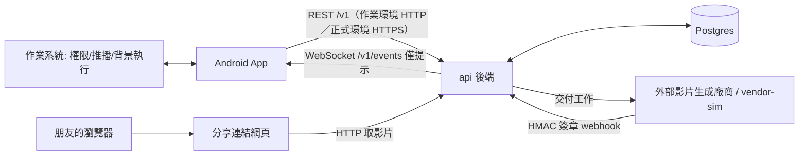

# ARCHITECTURE

> 狀態：進行中。本文件描述「將實作」的設計；第 2 輪的片段、點數、點數明細已實作並驗證（API 37 模擬器）；後端另已實作建單、額度、逾期釋放，第 4 輪的上傳自拍與送出，以及第 5.1 輪的派工給 `vendor-sim`、廠商 webhook、生成逾時與失敗退點（以真實 Postgres 與 Docker 驗證，第 5.1 輪當時未接 App）；App 已有生成進度畫面、前景服務與完成通知（第 5.2 輪，只在 API 37 模擬器驗證）；開啟 App 補發、通知權限檢查、訂單清單尚未實作。已定案內容與 `spec.md` 一致；尚未定案或要等實作的標 `待實作後補`；推論出的理由標 `[待確認]`。

## 1. 問題定義

> 原題：用你自己的話說明這個功能真正要解決什麼問題；列出你認為這份需求裡最難的 3 個問題，並說明為什麼難。

**這個功能真正要解決什麼問題：** 讓觀眾放心付點數、交出自己的臉、放著長時間的工作不管。即使網路、App 或廠商出事，點數也不會算錯，結果拿得到，分享與否由觀眾決定。

**最難的 3 個問題，以及為什麼難：**

1. **跨不可靠環節的點數正確性。** App、網路、後端、廠商之間任何一段都可能中斷、逾時或重送；請求成功但回應遺失時，App 無法知道後端做了什麼。點數一旦多扣、少退或重複扣，就是金錢問題 `[待確認]`。
2. **工作時間長於 App 生命週期。** 上傳在行動網路可能很久，生成要數分鐘，使用者會離開或被系統終止 App。進度、通知與結果必須在 App 不在時仍然正確，回來時能接續 `[待確認]`。
3. **App 守不住的規則與責任劃分。** App 在使用者手上，可被改造或不同版本共存；每日上限、浮水印、分享權限、點數都不能只靠 App。必須決定每條規則由誰負責，以及出事時誰是事實來源。

## 2. 系統邊界

> 原題：畫出 App、後端、外部服務、分享連結的網頁、作業系統（推播、背景執行、權限）之間的邊界。每條邊界上傳遞什麼、用什麼方式溝通、哪一邊是事實來源。

| 邊界 | 傳遞什麼 | 方式 | 事實來源 |
|---|---|---|---|
| App ↔ 後端 | 建單、上傳自拍、送出、查詢訂單／點數／quota／明細 | REST（`/v1`）：本作業環境走 HTTP，正式環境走 HTTPS；冪等鍵、`410`／`429` 等錯誤碼 | 後端 |
| 後端 → App | 「訂單有更新」提示 | WebSocket `GET /v1/events`，事件 `cameo_updated` | 後端（事件只是提示，狀態以 API 為準） |
| 後端 ↔ 廠商 | 交付工作；回報成功（附成品網址）或失敗（附原因） | 交付為 HTTP；結果為 HMAC 簽章 webhook | 後端記錄結果；廠商為生成工作的執行者 |
| App ↔ 作業系統 | 相機權限、通知、背景執行（前景服務） | 平台 API | 作業系統決定 App 是否被終止；App 的 Room `pending_cameos` 保存接續點 |
| 分享網頁 ↔ 後端 | 以分享連結取得影片 | HTTP，網頁只播放 | 後端（可隨時取消分享） |
| 背景通知 | 完成時通知使用者 | 前景服務（`dataSync`）：送出成功後啟動，每 10 秒查訂單，完成時發本機通知；正式推播服務只寫文件（見第 8 節） | App 在背景且未被強制停止時收到通知；被終止時開啟補發（尚未實作，排在 5.2 收尾） |

細節與 API 見 `README.md`。

## 3. 責任劃分

> 原題：每一條產品規則由誰負責做到（後端、App，或兩邊一起），為什麼。

| 產品規則 | 負責方 | 為什麼 |
|---|---|---|
| 只能用當場自拍 | App 負責只提供相機入口；後端不驗來源；裝置驗證只寫文件 | App 守不住：來源無法由後端驗證，真正防堵需要平台完整性檢查，只寫文件 `[待確認]`（其餘理由） |
| 生成短片一律帶浮水印 | 後端 | 後端只保存帶浮水印的成品，不提供無浮水印版本；真實情境由誰燒錄 `[待確認]` |
| 預設僅本人可看；分享後拿連結者可看；可隨時取消分享 | 後端（連結與取消） | 權限判斷必須在後端；細節待實作後補，連結設計 `[待確認]` |
| 每人每天最多 N 次（與點數無關） | 後端（`DAILY_LIMIT`、台北時間、建單占用）；App 只顯示 | App 守不住的規則；App 依 `GET /v1/quota` 在清單上方顯示；`remaining = 0` 時片段仍可點，點了跳提示、不進確認支付，`429` 時回清單重查 |
| 生成失敗退點 | 後端（同一交易退點寫 `REFUND`） | 點數正確性必須由單一事實來源在交易內保證 `[待確認]` |
| 點數使用明細 | 後端提供明細（`CHARGE`、`REFUND`）；App 顯示 | 明細與點數同一交易寫入，避免不一致 `[待確認]` |
| 照片隱私 | App 上傳成功刪本機照片；後端訂單結束後刪自拍 | 兩邊各自在持有端清理 `[待確認]`。後端在訂單進入終態（`EXPIRED`、`SUCCEEDED`、`FAILED`）的交易提交後刪自拍；送出後到終態之前檔案保留 |

## 4. App 內部架構

> 原題：模組怎麼切、依賴方向為何；如果明年要做另一個平台，哪些部分可以不用重新設計。

模組 `:domain` / `:data` / `:app`，依賴方向 `:app` → `:data` → `:domain`（`:app` 只能透過 `:domain` 介面使用資料層）。

- `:domain`：純 Kotlin（只依賴 Kotlin 標準庫與 coroutines），放 usecase、repository 介面與模型；視為可獨立成 repo 的 submodule；無 `@Inject`；不用 `java.*`。
- `:data`：repository 實作，預設 `internal`，依功能分資料夾。
- `:app`：View／ViewModel、Hilt 組裝、平台實作（相機、通知、前景服務等）。
- 後端同樣走 Clean Architecture：`backend/internal/{domain,usecase,adapter/...,app}`（`app` 提供服務啟動與逾期掃描，`backend/cmd` 負責組裝）與 `backend/test`（整合測試、測試用資料庫工具），Port 在 `usecase`，由 Go 測試檢查 import 方向。

**明年做另一個平台（iOS）可不用重新設計的部分：** 後端與 API 契約、狀態機與點數／額度規則、`:domain` 的規則與模型概念（以 Swift 重新表達）。需重寫的是 View、平台實作（相機、推播、背景任務）。`[待確認]`（iOS 實際重用程度）

細節見 `spec.md` 第 10、11 節。

## 5. 狀態與同步

> 原題：一次客串在整個系統裡的狀態機；App 怎麼拿到最新狀態、多個畫面怎麼保持一致、App 被系統終止後怎麼恢復。

**狀態機：** 見 `spec.md` 第 5 節（`AWAITING_UPLOAD` → `UPLOADED` → `QUEUED` → `GENERATING` → `SUCCEEDED`／`FAILED`；`EXPIRED`）。終態先到為準；轉為終態與點數處理在同一交易。

**點數狀態：** `points_state` 為 `HELD`（建單占用）、`CHARGED`（送出扣點）、`REFUNDED`（送出後失敗退點）、`RELEASED`（上傳階段過期釋放）。

**App 怎麼拿到最新狀態：** 以 API 為準。WebSocket 事件只是提示；打 API 的時機為開啟 App、回前景、收到提醒、重連成功、前景有未結束訂單時每 30 秒。

**多個畫面怎麼保持一致：** 各畫面都從同一個資料來源讀取，同步後一起更新，畫面不自行計算點數或狀態。

**上傳與送出（後端已實作）：**

- 上傳 `PUT /v1/cameos/{id}/selfie`：只收 JPEG（看內容前 3 bytes，不看 `Content-Type`）。順序是先查訂單擋掉明顯不能上傳的、串流寫暫存檔、再於交易內 `SELECT ... FOR UPDATE` 鎖列、重查狀態與期限、更新狀態並把暫存檔原子 rename 到正式位置。暫存檔與正式檔在同一個目錄（同一個檔案系統）。任何錯誤路徑都刪暫存檔；讀 body 中途失敗（連線中斷、內容少於 `Content-Length`）回可重試的 `408 UPLOAD_INTERRUPTED`，狀態與舊檔不變。
- 送出 `POST /v1/cameos/{id}/submit`：同一交易內固定先鎖點數帳戶、再鎖訂單列；先判斷期限、再判斷是否已上傳；扣款、寫 `CHARGE` 明細、轉 `QUEUED`／`CHARGED` 在同一交易。已是 `QUEUED` 之後的狀態直接回同一筆，不重複扣款。資料庫另以 partial unique index 保證每筆訂單最多一筆 `CHARGE`，明細的 `cameo_id` 有外鍵指向訂單。
- 逾期：背景掃描、上傳、送出三條路徑用同一條 SQL 規則（`upload_expires_at <= now`）。上傳與送出遇到已逾期但尚未被掃到的訂單，會在同一交易釋放並提交，之後才回 `410`（回傳錯誤會讓交易回滾，所以釋放與回應分開）。訂單轉 `EXPIRED` 的交易提交後才刪自拍；刪除失敗只記 log，不影響回應與掃描。
- 點數餘額與占用用單一 SQL 讀取（同一個快照），避免送出進行中讀到一半的狀態。

**生成與廠商回呼（後端已實作）：**

- 送出時同一交易寫入 `generation_expires_at = now + GENERATION_TTL`，期限涵蓋排隊與生成。背景掃描每個週期先處理逾時（`FailTimedOut`）、再派工（`DispatchDue`），依序執行；假設單一 `api` 實例，不做多實例協調。
- 派工：交易外查 `QUEUED` 且未逾期的訂單，呼叫 `VendorClient.Dispatch`（HTTP 不在資料庫交易內），廠商回 2xx 才開交易、仍是 `QUEUED` 才轉 `GENERATING`；失敗只記 log、下次重試（廠商以 `job_id` 去重，重送安全）。
- 廠商回呼 `POST /webhooks/vendor`：驗 HMAC 簽章後，單一交易內依序 `LockAccount` → 寫 `vendor_events`（`event_id` 主鍵，重複即略過）→ 鎖訂單列。`QUEUED`／`GENERATING` 才會被改變；終態以資料庫狀態為準，回呼內不比對期限，先到的為準。
- 鎖序：所有退款與回呼交易一律先鎖點數帳戶、再鎖訂單列（與送出相同），避免死鎖。
- 失敗流程（回呼失敗與逾時共用）：餘額加回建單快照的 `cost`、寫 `REFUND` 明細、訂單轉 `FAILED`／`REFUNDED`、寫 `failure_reason`，同一交易；資料庫 partial unique index 保證每筆訂單最多一筆 `REFUND`。

**App 被系統終止後怎麼恢復：** Room `pending_cameos` 記錄每次客串的 `step`（`CREATE`、`UPLOAD`、`SUBMIT`、`TRACK`），重新開啟後從該步驟接續；照片整檔重傳；建單以 `client_request_id` 冪等、送出靠訂單狀態可重複呼叫。訂單結束且通知發出後同一交易刪除該列。

## 6. 契約演進

> 原題：後端新增狀態、修改欄位、調整規則（例如每日上限）時，已經上架的舊版 App 怎麼辦；什麼情況下要強制使用者更新。

- App 忽略未知欄位與未知事件；未知的訂單狀態視為非終態；有後端 `display` 就顯示，沒有才用通用文字；兩種情況都重新查詢。
- 後端新增狀態、修改欄位：以向前相容為原則（只新增、不改語意）；破壞性變更走新版本路徑 `[待確認]`。
- 調整規則（例如每日上限）：值來自後端設定（`DAILY_LIMIT`）與 `GET /v1/quota` 回應，App 不寫死。
- 強制更新：後端對低於最低版本的 App 回 `426`（`upgrade_required`），App 顯示強制更新畫面。判斷門檻：已上架版本無法正確處理新契約時（例如金流語意變動）才強制更新 `[待確認]`。
- 強制更新的實作視進度可能只寫文件（見 `spec.md` 第 13 節）。

## 7. 失敗

> 原題：每條邊界可能怎麼失敗，使用者會看到什麼。

| 邊界 | 可能怎麼失敗 | 使用者看到什麼 |
|---|---|---|
| App ↔ 後端 | 建單或送出後回應遺失 | 建單重送以同一 `client_request_id` 不重複占用；送出重送靠訂單狀態，只扣一次點（待實作後補確切文字） |
| App ↔ 後端 | 上傳中斷 | 顯示重試中 `[待確認]`，整檔重傳。後端端：丟棄暫存檔、狀態與舊檔不變 |
| App ↔ 後端 | 上傳期限已過 / 送出晚於期限 | `410`；釋放占用、不扣款；顯示「上傳期限已過，點數沒有扣款，請重新客串。」 |
| App ↔ 後端 | 每日上限 | `429`，顯示後端 message 並重查 quota |
| 後端 → App | WebSocket 事件遺失 | 靠回前景、重連、30 秒同步補上 |
| 後端 ↔ 廠商 | 廠商回報失敗 | 顯示失敗並退點 |
| 後端 ↔ 廠商 | 重複回呼 | 只退一次、只通知一次 |
| 後端 ↔ 廠商 | 廠商不回呼 | 期限到後轉失敗並退點 |
| App ↔ 作業系統 | App 被終止 / 通知無法即時送達 | 開啟時補發，且只發一次（尚未實作，排在 5.2 收尾） |
| 契約 | App 版本過舊 | 強制更新畫面 |

「排隊中」「生成中」後接「完成後會通知你」，不提示廠商故障。`QUEUED`、`GENERATING` 的文字已定案，只有畫面待補。

## 8. 假設與取捨

> 原題：需求沒寫清楚的地方你怎麼判斷；考慮過哪些做法、為什麼選這個、刻意沒做什麼、什麼情況下會改變決定。

**需求沒寫清楚的地方怎麼判斷：** 見下表與 `spec.md` 第 2 節。

| 決定 | 放棄了什麼 | 為什麼選 | 什麼情況會改變 |
|---|---|---|---|
| 不做取消訂單 | 使用者主動中止 | 可能被洗 | `[待確認]` |
| 按下確認支付後再按返回，不視為取消；回應在頁面離開前回來時，流程照常上傳、送出、扣款 | 導到進度畫面前檢查頁面狀態，離開中就停在占用 | 按確認時已同意支付，規格也不做取消訂單；MVP 不為這個窗口增加自動扣款路徑的分支（專案負責人決定）。代價：使用者按確認後立刻返回仍可能被扣款，而且無法取消 | 正式版需要再評估（專案負責人決定） |
| 照片整檔重傳，位元組續傳列 backlog | 大檔續傳 | 續傳對照片意義不大 | 照片變大或網路極差時再評估 `[待確認]` |
| 建單占用、送出時扣點（預扣，詳見下方） | 簡單的先扣再退 | 概念來自信用卡預授權；使用者放棄上傳時，帳務和明細都更準確 | `[待確認]` |
| 上傳和送出拆成兩支 API | 單一 API 一次完成 | 每個 method 拆成最小行為，未來才好重用 | `[待確認]` |
| 上傳期限 1 小時、生成期限 30 分鐘 | 較長的期限（離線太久要重新建單） | 縮短點數被占用的時間 | `[待確認]` |
| 上傳階段過期時，點數釋放、額度退回（詳見下方） | 可以反覆建單不上傳，佔用資料列和自己的點數；同時最多占 3 單，對其他人和廠商成本無影響 | 有送給廠商才算用掉一次機會；廠商失敗或逾時不是使用者造成，也退額度；`CONTENT_REJECTED` 退點不退額度 | 建單本身開始產生成本，或真的出現大量這類訂單 |
| 只有相機入口，後端不驗來源 | 後端強制驗證 | 後端無法驗證照片來源 `[待確認]` | 需要時加入裝置驗證（目前只寫文件） |
| WebSocket 只作提示 | `[待確認]` | 事實一律以 API 為準（`spec.md` 第 6 節） | 進度落後時 WebSocket 可被砍 `[待確認]` |
| 離線優先列 backlog | 離線可建單 | 快取只用於顯示；不憑快取判斷能否建單 `[待確認]` | `[待確認]` |
| Android 為實作平台，Kotlin Compose | iOS 實作；代價：iOS 需另寫 View 與平台層 `[待確認]` | 作業技術棧相符 | `[待確認]` |
| 後端和 App 交錯開發 | 前後端平行開發（實際會想平行） | 這次因時間緊先交錯 | 時間充裕或有多人分工時改平行 `[待確認]` |
| 後端用 Go（Postgres、Docker） | 其他語言 | 專案負責人自述的理由 `[待確認]` | `[待確認]` |
| 背景完成通知用前景服務（`dataSync`，已定案） | 外部推播服務（作業限制不接）；細節見下方「背景完成通知的取捨」 | 不需要推播服務就能在背景收到完成通知；實測結果見 `docs/manual-test-checklist.md` 第 5.2 輪 | 接上正式推播服務後，改由後端推播取代輪詢 |
| 按「確認支付」時檢查通知，沒開就不能建新訂單（5.2 收尾實作，尚未實作） | 不檢查、沒開通知也能建單 | 讓進度頁「完成後會通知你」與 `spec.md` 第 7 節承諾成立（使用者決定）；代價：拒絕通知的人完全不能用客串功能 | 接上正式推播服務 |

**背景完成通知的取捨：** App 在送出成功後啟動前景服務，每 10 秒查訂單，完成時發本機通知。
- 原因：不接外部推播服務（作業限制）；模擬器實測回主畫面後服務持續輪詢，並在後端完成後約 3.7–7.1 秒內發出通知（第 1、2、3 項，基準為後端 `updated_at`；第 3 項等滿 10 分鐘，延遲 5.2 秒；第 4 項 2.9 秒的基準是回呼送出時間，不計入此範圍）。輪詢間隔 10 秒，所以最差約 10 秒；第 6 項曾出現 10.2 秒，因該項情境未能驗證而不計入。無服務時系統對背景網路有限制：`APP_BACKGROUND` 只有 1 次對照（n=1，服務未啟動那一輪 `effective=APP_BACKGROUND`，有服務的第 3 項 `effective=NONE`），見 `docs/manual-test-checklist.md` 第 5.2 輪。
- 代價：服務期間有常駐通知；每 10 秒輪詢耗電與流量；`force-stop` 後收不到通知；追蹤上限 35 分鐘（`GENERATION_TTL` 30 分鐘多留 5 分鐘讓逾時掃描和退點完成 `[待確認]`），超過不再通知；服務只存在記憶體，程序被殺就不再追蹤；沒有開通知的人不能建立新訂單（尚未實作，排在 5.2 收尾；見下一段）。
- 驗證範圍：只驗過 API 37 模擬器，長時間背景樣本 1 次，不代表真機、Doze 或廠牌省電模式。
- 何時會改：接上正式推播服務。
- 範圍與 `spec.md` 第 7 節一致：App 在背景且未被強制停止時收到通知；被終止時開啟補發（尚未實作，排在 5.2 收尾）。

**通知權限檢查（5.2 收尾實作；PoC 目前沒有這個檢查）：** 檢查點在 `POST /v1/cameos` 之前，用 `areNotificationsEnabled()` 判斷。通知可用就照常建單。通知不可用：系統還能顯示對話框就請求，同意才建單，拒絕就停在確認頁不建單；系統不再顯示對話框時，顯示 App 自己的提示「需要開啟通知才能客串」（有「前往設定」與「取消」），回來再按一次確認。App 開啟時不主動請求；進度頁不請求。已建立的訂單（未完成清單的繼續與重試）不擋；訂單進行中才關通知也不擋，這時收不到通知，開啟 App 時補發。代價：拒絕通知的人完全不能用客串功能。原因：讓「完成後會通知你」的文字與規格 §7 承諾成立（使用者決定）。

**SDK 版本的取捨：** 只有 `targetSdk` 用 36（`compileSdk` 為 37，因多個 AndroidX／OkHttp 依賴要求）。`targetSdk` 37 預設封鎖 App 連 `10.0.2.2`（區網位址），要多寫授權流程或手動操作；targetSdk 用 36 才能照 README 直接跑。什麼情況會改變：功能大致完成後再評估是否升 `targetSdk` 37，升級時要補執行時授權。

**假設：** PDF 沒定初始點數，模擬後端用 100 點。

**預扣與 PDF 最小交件順序的差異：** PDF 最小交件順序是「扣點 → 上傳並送出」。這裡改成「占用 → 上傳 → 送出時扣點」。概念來自信用卡預授權；使用者放棄上傳時，帳務和明細都更準確。代價：多一個占用狀態、金流測試更多；建單回應遺失時，點數仍要等到期才恢復。

**過期額度的取捨：** 上傳階段過期時，點數釋放、額度退回（`spec.md` 第 3、4 節規則不變）。判斷標準：有送給廠商才算用掉一次機會。但廠商失敗或逾時不是使用者造成，也退額度；`CONTENT_REJECTED` 退點不退額度。放棄的東西：可以反覆建單不上傳，佔用資料列和自己的點數；同時最多占 3 單，對其他人和廠商成本無影響。什麼情況會改：建單本身開始產生成本，或真的出現大量這類訂單。

### 異常：選了哪些、沒選哪些、為什麼

**實作（8 種）：**

| 異常 | 為什麼選 |
|---|---|
| `response_lost_after_commit` | 驗證重送不會重複占用點數 |
| `upload_interrupted` | 行動網路常見；驗證能從中斷的步驟接續 |
| `upload_expired` | 驗證逾期會釋放占用且不扣款 |
| `vendor_failed` | 驗證扣點後失敗會退點 |
| `vendor_duplicate_callback` | 驗證不會重複退點或重複完成 |
| `vendor_no_callback` | 驗證訂單不會永遠卡住，逾時會失敗並退點 |
| `socket_event_lost` | 驗證提醒遺失時仍能靠 API 補回狀態 |
| `upgrade_required` | 對業務重要 |

**只寫文件、不實作（5 種）：**

| 異常 | 為什麼不實作 |
|---|---|
| `server_error` | 走一般重試，沒有獨立的金流風險 |
| `slow_network` | 由逾時和重試涵蓋 |
| `vendor_dispatch_error` | 結果和 `vendor_failed` 相同，都走退點 |
| `vendor_out_of_order` | 和重複回呼同一機制，終態之後不再改變 |
| `unknown_status` | 有後端 `display` 就顯示，沒有才用通用文字；兩種情況都重新查詢，不牽涉金流 |

各異常的觸發方式與 App 表現：待實作後補（觸發方式見 `README.md`）。

### 技術選擇

建議技術（Kotlin、Jetpack Compose）與作業的技術棧一致，未改用其他語言或框架。後端使用 Go（作業允許模擬後端語言不限）；理由為專案負責人自述，內容與代價：`[待確認]`。

### 實作計畫

排程與砍項順序見 `spec.md` 第 13 節。
