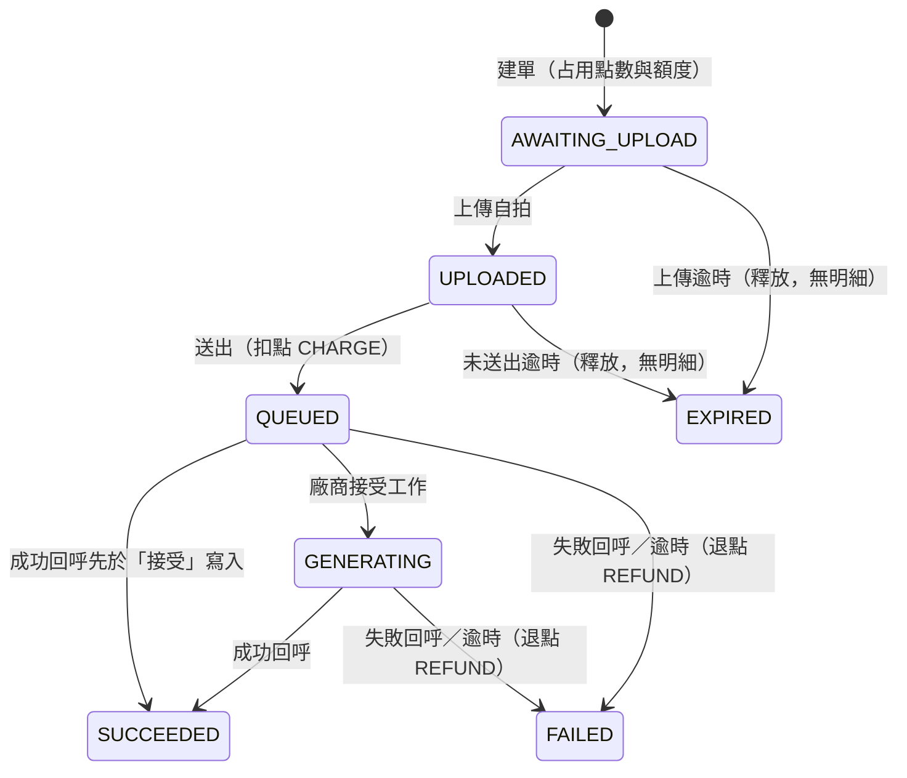

# 客串短劇：App 規格

> 第 1–6 章從 `spec.md` 整理，第 7–9 章是實作計畫與決定紀錄。只含 App。畫面行為（第 2 章）以本文件為準，其他有衝突時以 `spec.md` 為準；內文未標明的章節號都指 `spec.md`；後端規則見 `spec-server.md`；`[待確認]` 沿用原標記。

## 1. 目標與範圍（§1、§2、§9）

- **目標：**
  讓觀眾放心付點數、交出自己的臉、放著長時間的工作不管。即使網路、App 或廠商出事，點數也不會算錯，結果拿得到，分享與否由觀眾決定。

- **範圍（§2）：**
  - 不做取消訂單（可能被洗）。
  - 中斷後從步驟接續；照片整檔重傳（位元組續傳列 backlog，見第 12 節）。
  - 登入與使用者：假設已用一個測試帳號登入。片段清單與初始點數由模擬後端提供，App 沒有假資料層。
  - 只有相機入口，上傳的是 JPEG 照片（影片不適用）。
  - App 上傳成功後刪除本機照片。

- **Android 技術與硬性限制（§9）：**
  - Android：Kotlin、Jetpack Compose、Hilt、Room、KSP、OkHttp／Retrofit、CameraX（`1.6.2`，`camera-core`、`camera-camera2`、`camera-lifecycle`、`camera-view`）、Media3。
  - App 與後端都走 Clean Architecture。
  - 硬性限制：
    - 乾淨電腦用一行指令啟動後端，照 README 在模擬器上執行 App。
    - 不依賴個人帳號、金鑰或 Firebase。
    - 設定值（後端網址等）不寫死在畫面。
    - 關鍵邏輯的測試不需啟動 App。
    - 實作一個平台（Android），設計涵蓋 iOS 與 Android。

## 2. 畫面行為（目標，尚未實作）（§10）

本章引用的章節號指 `spec.md`。

本小節是 App 的完整行為依據，尚未實作也尚未實測；實作完成前，App 實際行為仍以其他章節標為「已實作」的內容為準。

**頁面結構**

- 沒有底部導覽。App 只有一個首頁「我的客串」，其他都是從首頁進入的單一導覽堆疊。
- 首頁上方是待處理區，下方是已送出區，兩區放在同一個列表；同一筆訂單只出現在一處。
- 待處理區：尚未建單、未上傳、未送出、已過期、暫時查不到狀態的訂單。訂單狀態為 `QUEUED`、`GENERATING`、`SUCCEEDED`、`FAILED`，或查不到狀態但本機步驟已是 `TRACK`，都不算待處理；這些情況的本機草稿不因此刪除（草稿仍負責通知去重）。
- 已送出區：`QUEUED`、`GENERATING`、`SUCCEEDED`、`FAILED` 的訂單，來自 `GET /v1/cameos?cursor=`。
- 右上顯示可用點數（例如「90 點」），按鈕一律可點進點數明細。尚未取得或第一次就失敗時顯示「- 點」，兩者不區分；取得失敗保留舊值。
- 右下的 FAB「＋客串」開始客串流程。「回到頂端」按鈕放底部置中，避免和 FAB 重疊。
- 術語對照：其他章節的「未完成列」「未完成清單」，改版後對應「待處理區」；「片段清單」對應「選片段流程頁」。
- 載入：已送出區第一次載入失敗時，待處理區照常顯示，已送出區顯示錯誤和重試。兩區都沒有資料時顯示「還沒有客串」。
- 待處理區的列操作：
  - 尚未建單：「繼續」（走權限檢查）和「移除」。
  - 未上傳、未送出：「繼續」，不擋。
  - 已過期：「重新客串」和「移除」。
  - 暫時查不到狀態：顯示「暫時無法取得狀態」，沒有操作；下次更新時重新判斷。
  - 「移除」的出現規則沿用本節建單失敗表與第 7 節，本小節不新增規則。

**開始客串與權限**

- 流程：FAB → 選片段（流程頁，顯示額度）→ 拍照 → 確認支付 → 上傳送出 → 成功自動回首頁。
- 按 FAB 時先檢查通知，再檢查相機。通知可用的判斷沿用第 7 節。
- 系統還能詢問就詢問；使用者拒絕時留在首頁並說明原因；系統不能再詢問時，提供「前往設定」；從設定回來要再按一次 FAB。
- 「重新客串」和尚未建單的「繼續」走同一個檢查。已建單（未上傳、未送出）的「繼續」不擋。
- 「重新客串」先看額度，再查權限。額度用完時顯示提示，不跳權限對話框、不建單、不刪草稿。額度和權限都通過才刪草稿；權限被拒就留著。
- 首頁的額度跟待處理區一起載入和更新；按「重新客串」時用已載入的額度判斷。額度尚未載入時放行，建單時由後端 `429` 擋下。
- 相機頁的權限拒絕畫面保留作備援。App 開啟時不主動請求權限，確認頁和進度頁也不請求。

**進度頁出口**

- 建單後進進度頁時，選片段和確認頁移出導覽堆疊，進度頁按返回回首頁。
- 送出成功：啟動追蹤後自動回首頁。
- 上傳失敗、照片無效、訂單過期：留在進度頁。
  - 上傳失敗：可重試時有「重試」和「回我的客串」；不能重試時只有「回我的客串」。
  - 照片無效：「重新拍照」和「回我的客串」。
  - 訂單已過期：只有「回我的客串」，不提供重新客串；要重新客串一律從首頁待處理列開始。
- 還原進度頁時，若訂單已送出或草稿已不存在，直接回首頁。訂單未上傳或未送出時，留在進度頁自動接續。

**狀態更新**

- 3 秒輪詢只查已送出區裡可視的 `QUEUED`、`GENERATING`，用 `GET /v1/cameos/{id}` 就地更新；不可視的訂單輪詢不查。
- 待處理區不參與 3 秒輪詢。待處理區、餘額、額度在回前景、回首頁時更新；待處理訂單到期後，要到那時才顯示已過期，可用點數也到那時才更新。
- 上述限制只管 3 秒輪詢：回前景的草稿狀態查詢、第 7 節的通知補發查詢、背景服務每 10 秒查詢都不受限。
- 可視範圍改變後，捲動停 0.3 秒就立刻查，之後回到每 3 秒。
- 進入背景或離開首頁就停止；回到首頁重新開始。
- 查詢失敗不顯示錯誤，下一輪再查。
- 訂單變成 `FAILED` 時立刻更新餘額。
- 依 id 合併只用於我的客串；點數明細維持整份取代（保留閱讀位置仍在 `spec.md` 第 12 節 backlog）。回前景與返回首頁時重新取第一頁，依 id 合併：更新既有項目、新項目放最前、保留已載入的項目與游標；第一頁和現有列表完全沒有重疊時才整份取代。刷新失敗不清空列表。
- 捲動：回前景與回首頁合併時，一般情況捲動位置不變。有新訂單時，看得到列表頂端（只露出一部分也算）就捲回頂端；看不到就不動，並顯示「回到頂端」（列表頂端離開畫面就出現，看得到就消失，點擊回到頂端）。新訂單如果被待處理列擠到畫面外，不另外定位。例外：第一頁和現有列表完全沒有重疊而整份取代時，不保留位置。
- 待處理列出現或增加時，更新前看得到列表頂端（只露出一部分也算）就捲回頂端，讓它看得到；看不到就不動。尚未實作。
- 背景服務維持每 10 秒查詢；服務正常查詢時，通知通常在完成後約 10 秒內發出（不是實測結論）。
- 點完成通知：回首頁並更新，流程頁結束，等同離開該頁。
- 額度用完：選片段頁與重新客串都顯示提示，不建單、不刪草稿。

**白話情境表**

| 情境 | 使用者看到 |
|---|---|
| 進入 App | 首頁，載入兩區與餘額 |
| 停著等生成完成 | 可視項目約 3 秒內更新 |
| 生成失敗 | 列變成失敗，餘額更新；若該列不可視，捲到才更新；第一頁以內的列回前景時也會更新 |
| 按 Home 再回來 | 列表更新、位置不跳 |
| 程序被殺後重開 | 有可還原的流程頁：留在該頁；進度頁的訂單未上傳或未送出時自動接續，過期或失敗時顯示「進度頁出口」的操作。沒有可還原的流程頁，或訂單已送出、草稿已不存在：回首頁，已完成且通知可用時補發一次 |
| 旋轉 | 內容與捲動位置不變 |
| 拍照、確認頁按返回 | 回選片段；從進度頁重拍時，相機按返回回首頁 |
| 從待處理區進來的流程頁按返回 | 回首頁 |
| 選片段按返回 | 回首頁 |
| 進度頁按返回 | 回首頁，訂單留在待處理區或已送出區 |
| 網路失敗 | 列表保留舊資料 |

**已知限制**

- 草稿表同時負責接續與通知去重，這次不重構。
- 畫面層沒有自動化測試，計畫靠 ViewModel 測試和 integration 實測。
- 第一次使用可能連續跳兩個權限對話框。
- 不可視的失敗訂單：捲到才更新；第一頁以內的列回前景時也會更新。餘額會等到捲到或回前景、回首頁才更新。
- 上傳途中進背景尚未實測。

## 3. 目前程式的行為（§2、§3、§7）

本章是目前程式的行為，改版完成前有效；與第 2 章不同處，目標以第 2 章為準。標註「改版後」的句子說明會改成什麼。第 3、4 章合起來是 `spec.md` §7（另含 §2、§3 的條目），其中的「本節」「下方」指 §7 全節。

- 「我的客串」（PDF 第 4 點，必做）：列出所有生成過的短片與狀態（含 `display` 文字）。排在第 5.2b 階段（第 5.3 之前）：後端 `GET /v1/cameos?cursor=`、App「我的客串」頁、點通知開這一頁；第 7 輪在此頁加播放和分享入口。目前後端 `GET /v1/cameos?cursor=` 已實作（5.2b-1）；App「我的客串」頁已實作（5.2b-2：底部導覽第三分頁、游標分頁、每次回到前景靜默刷新第一頁，列不可點）；點完成通知開此頁已實作（5.2b-3：只切到分頁、不定位單筆）。回前景刷新（H2 已實作，細節見下方）：依 id 合併第一頁；第一頁和現有列表完全沒有重疊時整份取代，這時位置可能改變。已知代價：已載入但不在第一頁的項目不會被更新；不在前景的頁面不輪詢；回前景或資料更新時，若第一筆在畫面上（只露出一部分也算）而且出現新的第一筆，列表自動捲到新的第一筆；第一筆不在畫面上時不捲動、位置不變，並在右下角顯示「回到頂端」（第一筆離開畫面就出現、看得到就消失，點擊回到第一筆），看到的是最近一次查詢結果。
- 列表依 id 合併已實作（H2）；「我的客串」成為首頁的改版尚未實作，見本文件第 2 章。
- 未完成列（H1 已實作，單元測試涵蓋，模擬器實測排在 H9）：訂單為 `QUEUED`、`GENERATING`、`SUCCEEDED`、`FAILED`，或查不到狀態但步驟是 `TRACK` 時不列出，草稿不刪；`CAMEO_NOT_FOUND` 仍刪草稿。
- 我的客串的回前景刷新（H2 已實作，單元測試涵蓋，模擬器實測排在 H9）：依 id 合併第一頁，就地更新既有項目、新項目放最前、保留已載入項目與游標；第一頁和現有列表完全沒有重疊時整份取代；刷新失敗不清空列表。點數明細維持整份取代。

App 行為：

- `remaining > 0`：片段清單顯示 `display`。
- `remaining = 0`：清單上方顯示已用完與重置時間；片段仍可點，點了跳提示，不進確認支付、不建單；未完成的客串不受影響。
- 建單遇 `429`：顯示後端 `message` 並重新查詢 quota。
- 與訂單同步時機一起查（開啟 App、回前景），建單後也查。
- 改版後這些額度顯示在選片段流程頁，重新客串也做同樣檢查；尚未實作，見本文件第 2 章。

- 通知權限（已實作，單元測試涵蓋，模擬器實測排在 5.3）：按「確認支付」時、`POST /v1/cameos` 之前檢查「通知可用」：`areNotificationsEnabled()` 為 true，**且**「生成結果」頻道的 importance 不是 `IMPORTANCE_NONE`（API 26+；頻道還沒建立視為可用）。確認頁 gate、回前景補發、前景服務發通知前都用同一個判斷。通知可用就照常建單；頻道被關（App 通知開著）時一律顯示「前往設定」提示、不跳權限對話框，`ACTION_APP_NOTIFICATION_SETTINGS` 導到 App 通知設定；其餘不可用時，系統還能顯示對話框就請求，同意後重新檢查，通知可用才建單、頻道仍關就顯示提示，拒絕就停在確認頁不建單；系統不再顯示對話框時，顯示 App 自己的提示「需要開啟通知才能客串」（「前往設定」與「取消」），回來再按一次確認。App 開啟時不主動請求；進度頁不請求。
- 有 `cameoId` 的訂單（未完成清單的繼續、重試）不擋；還不確定是否建單的 `CREATE` 草稿（建單請求可能已到伺服器）會到確認頁並經過通知檢查。代價：通知關著時，這筆可能要等上傳期限才釋放點數。訂單進行中才關通知也不擋，這時收不到通知，草稿保留，開啟 App 時補發。通知關閉時保留的草稿，若訂單已送出（`QUEUED`、`GENERATING`、`SUCCEEDED`、`FAILED`）或查不到狀態但步驟是 `TRACK`，不在未完成清單上（H1 已實作，單元測試涵蓋，模擬器實測排在 H9）；這時也建不了新單，不會累積。查不到狀態且步驟不是 `TRACK` 時仍會列出，顯示「暫時無法取得狀態」，沒有按鈕，查到狀態後依狀態決定是否列出。
- 代價：拒絕通知的人完全不能用客串功能。原因：讓進度頁「完成後會通知你」與本節承諾成立（使用者決定）。
- 改版後，上面的確認頁通知檢查，以及 `CREATE` 草稿到確認頁的通知檢查，都改為在按 FAB、重新客串或尚未建單的「繼續」時檢查；有 `cameoId` 的訂單不擋不變。尚未實作，見本文件第 2 章。
- 未完成清單與結果入口：已送出的訂單在草稿刪除前就不列在未完成清單（條件見未完成列規則），結果由「我的客串」頁提供（5.2b-2 已實作）；點完成通知會開到「我的客串」分頁（5.2b-3 已實作）：只開到分頁、不定位單筆；已在此分頁時留在此頁並刷新。點通知一律開「我的客串」（使用者決定）。前景在相機、確認、進度頁時，這些流程頁會結束，等同離開該頁，進行中的上傳或建單會中止，之後從未完成列接續（接續未實測，排 5.3）。

## 4. 背景追蹤與通知（§7）

本章與第 3 章合起來是 `spec.md` §7，「本節」「下方」指 §7 全節。

- 承諾：App 在背景且未被強制停止時收到通知。
- App 被終止：開啟（回到前景）時補發，且只發一次（已實作，單元測試涵蓋，模擬器實測排在 5.3）。對所有有 `cameoId` 的草稿查一次訂單：`SUCCEEDED`／`FAILED` 先刪本機草稿（原子，刪到才算認領）、認領成功就立刻發通知（每筆各自「認領＋通知」，包在不可取消的區塊內）；`QUEUED`／`GENERATING` 重新啟動前景服務追蹤；其他狀態與查詢失敗不動。前景服務到結束狀態也走同一個「先刪草稿、刪成功才發通知」流程，這是「只發一次」的唯一機制。
- 取捨：先刪再發。不會補發（少發，不重發）的情況：認領之後、發通知之前程序被殺（進程中止）；另有回前景判斷「通知可用」到實際認領之間使用者剛好關掉通知的極窄窗口，這時草稿已刪、不補發（讀碼推論，未實測）；協程取消不會少發，因為認領與通知在同一個不可取消區塊。通知不可用（見下方通知權限）時不刪草稿、不通知，等通知可用後開啟 App 再補發。
- 權限旗標：「已請求過」旗標在收到權限結果時寫入，對話框被取消（dismiss）時也會寫入，之後走「前往設定」路徑（Android 行為為推論，未實測）。
- 做法已定案：前景服務（`dataSync`）。App 在送出成功後啟動前景服務，每 10 秒查訂單，完成時發本機通知（取捨見 `ARCHITECTURE.md` 第 8 節）。
- 後端靠廠商 webhook 得知結果；正式推播服務只寫文件，不實作。

## 5. 會用到的後端約定（§3、§4、§5、§6）

欄位細節見 README；以下為 `spec.md` 原文（端點清單除外）。

`GET /v1/quota` 回應：

```json
{"remaining":2,"resets_at":"2026-11-07T00:00:00+08:00","display":"今日還可客串 2 次"}
```

- `GET /v1/points` 回 `{available, held}`，`available = balance - held`。
- 確認支付提示：確認前顯示「確認後會占用 N 點，送出後才扣款」；建單後顯示後端 `display`（「已占用 N 點，送出後才扣款」）。
- 訂單回傳 `points_state`：`HELD`、`CHARGED`、`REFUNDED`、`RELEASED`。

訂單狀態（後端為事實來源）：



顯示文字：

| 狀態 | 文字 |
|---|---|
| `AWAITING_UPLOAD` | 標題「等待上傳」，說明「已占用 N 點，送出後才扣款」 |
| `EXPIRED` | 標題「已過期」，說明「上傳期限已過，點數沒有扣款，請重新客串。」 |
| `UPLOADED` | 標題「送出中」，說明「照片已上傳，尚未扣款」 |
| `QUEUED` | 標題「排隊中」，說明「完成後會通知你」 |
| `GENERATING` | 標題「生成中」，說明「完成後會通知你」 |
| `SUCCEEDED` | 標題「已完成」，說明「你的客串短片完成了」 |
| `FAILED`，原因 `CONTENT_REJECTED` | 標題「無法生成」，說明「照片未通過審核，點數已退還，今日次數不退還」 |
| 其他 `FAILED`（`VENDOR_FAILED`、`TIMEOUT`） | 標題「生成失敗」，說明「點數已退還」 |

不向使用者提示廠商故障。未知狀態用通用文字「處理中」。

`failure_reason`：`CONTENT_REJECTED`（退點、不退額度，只有這個值不退額度）、`VENDOR_FAILED`（廠商回報失敗且原因不是 `CONTENT_REJECTED`）、`TIMEOUT`（生成期限到仍無結果）；後兩者退點也退額度。

- 打 API 同步的時機：開啟 App、回前景、回首頁；前景輪詢見本文件第 2 章。

App 用到的其他端點（路徑來自 `README.md`）：

- `GET /v1/clips`
- `GET /v1/points/ledger?cursor=`
- `POST /v1/cameos`
- `PUT {upload.url}`（即 `/v1/cameos/{id}/selfie`）
- `POST /v1/cameos/{id}/submit`
- `GET /v1/cameos?cursor=`
- `GET /v1/cameos/{id}`
- `GET /v1/cameos/{id}/video`（第 7 輪）：不存在回 `404 CAMEO_NOT_FOUND`，非 `SUCCEEDED` 回 `404 VIDEO_NOT_READY`
- `PUT`、`DELETE /v1/cameos/{id}/share`（第 7 輪）：`PUT` 成功回 `200`，非 `SUCCEEDED` 回 `409 NOT_SHAREABLE`，分享中重複 `PUT` 得到同一個 URL；`DELETE` 冪等回 `204`；訂單不存在兩者都回 `404 CAMEO_NOT_FOUND`
- 第 7 輪起播放與分享入口依訂單的 `video_available`（`SUCCEEDED` 時為 true）和 `share`（`{"active":...,"url":...}`）判斷；約定細節見 `README.md`「影片與分享」

## 6. App 架構（§10）

模組 `:domain` / `:data` / `:app`：

- `:domain`：視為未來可獨立成 repo 的 submodule。只依賴 Kotlin 標準庫和 coroutines，放 usecase、repository 介面與模型；無 `@Inject`；可獨立建置與測試；不用 `java.*`。
- `:data`：實作預設 `internal`，依功能分資料夾。
- `:app`：只放 View／ViewModel、組裝（Hilt）、平台實作。

工具鏈（iteration 2 已建置並跑過單元測試與 API 37 模擬器）：Gradle 9.5.0、AGP 9.3.1、Kotlin 2.2.10、Compose BOM 2026.06.01、compileSdk 37、targetSdk 36（多個 AndroidX／OkHttp 依賴要求 compileSdk 至少 37；targetSdk 用 36 的原因見 `ARCHITECTURE.md` 第 8 節）、minSdk 26、JDK 21 toolchain（foojay 自動下載）。Hilt 2.60.1、Room 2.8.5、KSP 2.3.13 可與上述版本一起建置。`kotlinx-serialization` 用 1.9.0：1.12.0 的 metadata 版本高於 Kotlin 2.2.10 編譯器可讀，無法編譯。`kotlin-stdlib` 實際由依賴解析到 2.3.21，`kotlinx-serialization` 維持 1.9.0。

驗收：`:domain` 能獨立建置與測試；`:app` 無法直接使用 `:data` 的實作；Hilt 綁定可建置。

做法：模組邊界、純模型、規則集中、狀態機測試、手動驗證。

### Room `pending_cameos`

每次客串一列：

| 欄位 | 說明 |
|---|---|
| `client_request_id` | 主鍵／冪等鍵 |
| `clip_id` | 片段 |
| `cameo_id` | 建單後取得 |
| `step` | `CREATE`、`UPLOAD`、`SUBMIT`、`TRACK` |
| `photo_path` | 照片在私有目錄；上傳成功刪檔並清空；查到訂單為 `EXPIRED` 時也刪檔並清空（資料列保留，讓使用者看到過期並選擇重新客串或移除） |
| `last_error` | 最近一次錯誤 |
| `updated_at` | 更新時間 |

訂單結束（`SUCCEEDED`／`FAILED`）時先以單一 `DELETE ... WHERE cameo_id` 刪除該列（刪到 1 列才算認領），認領成功才發通知；刪列時一併刪本機照片。不是同一交易：通知發出前程序被殺，這則就不會補發。點數、額度、訂單狀態、片段、明細不放 Room。

建單失敗時草稿的處理：

| 錯誤 | 此 key 有訂單嗎 | 草稿 | 畫面 |
|---|---|---|---|
| `402`、`429`、`404 CLIP_NOT_FOUND` | 確定沒有（後端查過冪等鍵才回） | 刪除 | 顯示訊息，回片段清單 |
| `5xx`、網路錯誤、回應遺失 | 不確定 | 保留 | 顯示「重試」，用同一個 key |
| 其他 `retryable=false`（`400`、`401`、`409`、`426`、非 JSON 4xx） | 不確定 | 保留並記錄錯誤 | 顯示訊息，不顯示重試；未完成列可「繼續」（同一個 key）或「移除」 |

移除後，如果該 key 其實已建單，訂單只占用點數與當日額度、沒有扣款，由後端在上傳期限後釋放。

## 7. 測試分層

- 業務規則用 usecase 測試；畫面狀態用 ViewModel 測試（假 repository 與虛擬時間）。
- 背景限制、真實通知、程序被殺、相機與畫面接線，集中在 integration 驗證。
- 模擬器只在 integration 跑，其他階段跑單元測試和建置。
- 目前不導入 Robolectric 和 Compose UI 測試，所以畫面層沒有自動化測試；這個缺口要寫進 `ARCHITECTURE.md`。
- 每個階段一次只做一件事；動工前要寫清楚要改的函式、失敗與取消時的行為、要抓哪個 mutation。

## 8. 實作階段

H0（規格）已完成；以下依序進行，每階段結束後 App 都要能建置並跑通主流程。

| 階段 | 只做這件事 | 完成後看到的結果 | 測試要抓的錯 |
|---|---|---|---|
| H1 待處理規則 | `GetUnfinishedCameosUseCase` 排除 `QUEUED`、`GENERATING`、`SUCCEEDED`、`FAILED`；查不到狀態但步驟是 `TRACK` 也排除；草稿不刪。`CAMEO_NOT_FOUND`（404）維持現行刪草稿。 | 已送出的訂單不再出現在未完成列 | 拿掉過濾；誤刪草稿；把 404 也當查不到狀態而保留草稿 |
| H2 列表合併 | 只用於我的客串，點數明細維持整份取代（例如以參數傳入取 id 的方式；未傳就整份取代）。`PagedList.refresh()` 依 id 合併第一頁：更新既有、新項目放最前、保留已載入項目與游標；沒有重疊才整份取代 | 回前景不再跳位置 | 掉資料或沒去重；沒有重疊仍合併；刷新失敗清空列表；點數明細也被合併 |
| H3 導覽骨架 | 刪除 `MainTabs`、`tabNav`、`navigateToTab`、`handledRequest`，改成單一堆疊，首頁是我的客串；加上 FAB 和點數入口；點通知回首頁。「回到頂端」移到底部置中。 | 底部導覽消失，FAB 進選片段，右上進明細 | ViewModel 沒有新規則，主要在 H9 實測 |
| H4 待處理區搬家 | 待處理區移到首頁，額度邏輯抽成共用，選片段頁變成流程頁。兩區各自載入與空狀態（已送出區首次載入失敗時待處理區照常顯示；兩區都沒資料才顯示「還沒有客串」）；回到頂端與自動捲動依第 2 章；首頁載入片段清單，供尚未建單列顯示片段名稱。 | 首頁上方待處理、下方已送出，同一筆只出現一處 | `restart` 不檢查額度；額度用完仍刪草稿；待處理區沒有刷新；已送出區載入失敗蓋掉待處理區；只有一區有資料卻顯示空狀態；額度未載入時擋下重新客串 |
| H5 餘額 | 右上顯示可用點數，取得失敗保留舊值 | 看得到餘額，未取得時顯示「- 點」 | 失敗時清掉舊值；回首頁沒更新 |
| H6 進度頁出口 | 建單後把選片段和確認頁移出堆疊；送出成功自動回首頁；刪除 `Done`、`Gone` 畫面；過期只留「回我的客串」。照片無效與上傳失敗都有「回我的客串」，取代「回片段清單」；不能重試的上傳失敗不顯示「重試」；還原規則依第 2 章。 | 送出成功回首頁，上傳失敗留在進度頁 | 成功沒回首頁；失敗被帶走；追蹤沒啟動；不能重試仍顯示重試；照片無效沒有回首頁的操作 |
| H7 權限 | 新增檢查權限的純函式並接到 FAB、重新客串、尚未建單的「繼續」；確認頁拿掉通知檢查。沿用 `decideNotificationGate`，不另寫通知判斷；額度和權限都通過才刪草稿。 | 按 FAB 先問通知再問相機，拒絕就留在首頁 | 沒檢查相機就放行；拒絕後放行；重新客串繞過；已建單的「繼續」被擋；權限被拒卻刪了草稿 |
| H8 可視輪詢 | 新增 `pollVisible` 和 `PagedList.updateItem()`，每 3 秒查已送出區可視的 `QUEUED`、`GENERATING`，捲動停 0.3 秒後查；變失敗時更新餘額。背景或離開首頁就停止，回首頁重新開始。 | 停在首頁，狀態會自己更新 | 查了不可視或已結束的訂單；拿掉 debounce；間隔錯誤；目標為空仍請求；失敗後停止輪詢；失敗沒更新餘額；離開首頁仍在查；回首頁沒重啟 |
| H9 Integration | 在模擬器跑完整情境，驗證結果寫進現況欄，再把已驗證與未涵蓋項目整理進 README。第 3、4 章標「排在 5.3」的驗證併入此階段。 | 有實測證據，沒有新功能 | 主流程；失敗退點與餘額；背景通知；強制停止後恢復追蹤；程序被殺後還原；點通知回首頁；接續只扣一次；logcat 確認只查可視項目；拒絕通知與相機；長列表回前景位置不跳；建單失敗返回首頁時，原本看得到頂端則待處理列看得到，原本看不到頂端則位置不動、顯示「回到頂端」；旋轉時內容與位置不變 |

停損點：11/07 結束時 H6 還沒完成，或 11/08 開始時 H8 還沒完成，就先做播放、分享和至少 3 種異常，剩下的改版寫進 `ARCHITECTURE.md`。如果已過 H6，H7、H8 可以延後，但確認頁的舊權限檢查和現有的回前景刷新要留著。

上傳途中進背景：本機上傳太快，難以控制時機，H9 不測，列為未涵蓋。

## 9. 待決定

目前沒有待決定事項。`[待確認]` 項目見 `spec.md` §14。
