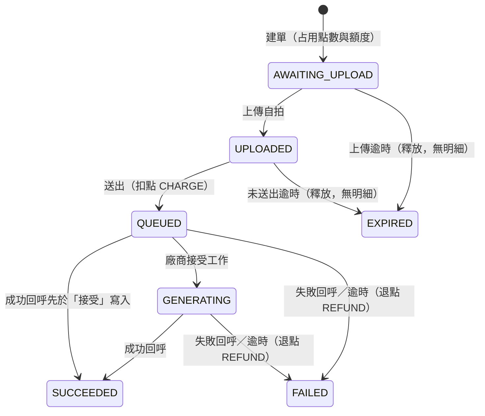

# 客串短劇：App 規格

> 第 1–6 章從 `spec.md` 整理，第 7–9 章是實作計畫與決定紀錄。只含 App。畫面行為（第 2 章）以本文件為準，其他有衝突時以 `spec.md` 為準；內文未標明的章節號都指 `spec.md`；後端規則見 `spec-server.md`；`[待確認]` 沿用原標記。

## 1. 目標與範圍（§1、§2、§9）

- **目標：**
  讓觀眾放心付點數、交出自己的臉、放著長時間的工作不管。即使網路、App 或廠商出事，點數也不會算錯，結果拿得到，分享與否由觀眾決定。

- **範圍（§2）：**
  - 不做取消訂單（可能被洗）。
  - 中斷後從步驟接續；照片整檔重傳（位元組續傳列 backlog，見第 12 節）。
  - 登入與使用者：假設已用一個測試帳號登入。片段清單與初始點數由模擬後端提供，App 沒有假資料層。
  - 只有相機入口，上傳的是 JPEG 照片（影片不適用）。
  - App 上傳成功後刪除本機照片。

- **Android 技術與硬性限制（§9）：**
  - Android：Kotlin、Jetpack Compose、Hilt、Room、KSP、OkHttp／Retrofit、CameraX（`1.6.2`，`camera-core`、`camera-camera2`、`camera-lifecycle`、`camera-view`）、Media3。
  - App 與後端都走 Clean Architecture。
  - 硬性限制：
    - 乾淨電腦用一行指令啟動後端，照 README 在模擬器上執行 App。
    - 不依賴個人帳號、金鑰或 Firebase。
    - 設定值（後端網址等）不寫死在畫面。
    - 關鍵邏輯的測試不需啟動 App。
    - 實作一個平台（Android），設計涵蓋 iOS 與 Android。

## 2. 畫面行為（目標，部分已實作）（§10）

本章引用的章節號指 `spec.md`。

本小節是 App 的完整行為依據，部分已實作；各項實作與實測狀態見下方「我的客串」起的現況欄。

**頁面結構**

- 沒有底部導覽。App 只有一個首頁「我的客串」，其他都是從首頁進入的單一導覽堆疊。
- 首頁上方是待處理區，下方是已送出區，兩區放在同一個列表；同一筆訂單只出現在一處。
- 待處理區：尚未建單、未上傳、未送出、已過期、暫時查不到狀態的訂單。訂單狀態為 `QUEUED`、`GENERATING`、`SUCCEEDED`、`FAILED`，或查不到狀態但本機步驟已是 `TRACK`，都不算待處理；這些情況的本機草稿不因此刪除（草稿仍負責通知去重）。
- 已送出區：`QUEUED`、`GENERATING`、`SUCCEEDED`、`FAILED` 的訂單，來自 `GET /v1/cameos?cursor=`。
- 右上顯示可用點數（例如「90 點」），按鈕一律可點進點數明細。尚未取得或第一次就失敗時顯示「- 點」，兩者不區分；取得失敗保留舊值。
- 右下的 FAB「＋客串」開始客串流程。「回到頂端」按鈕放底部置中，避免和 FAB 重疊。
- 術語對照：其他章節的「未完成列」「未完成清單」，改版後對應「待處理區」；「片段清單」對應「選片段流程頁」。
- 載入：已送出區第一次載入失敗時，待處理區照常顯示，已送出區顯示錯誤和「重試」；回前景或回首頁時自動重新載入，再次失敗仍顯示錯誤和「重試」，待處理區不受影響。已有資料時刷新失敗：保留舊列表，不顯示推開列表的錯誤區，改跳短暫 Snackbar（錯誤訊息和「重試」）；每次刷新失敗跳一次，下次回前景也會再查。輪詢查詢失敗不顯示錯誤，也不跳 Snackbar。以上不含點數明細頁。兩區都沒有資料時顯示「還沒有客串」。片段名稱取不到時，待處理列顯示「（片段）」。
- 待處理區的列操作：
  - 尚未建單：「繼續」（走權限檢查）和「移除」。
  - 未上傳、未送出：「繼續」，不擋；目前沒有「移除」，不繼續就等上傳期限到，點數自動釋放，再從已過期列移除（未來功能見 `spec.md` 第 12 節）。
  - 已過期：「重新客串」和「移除」。
  - 暫時查不到狀態：顯示「暫時無法取得狀態」，沒有操作；下次更新時重新判斷。
  - 「移除」的出現規則沿用本節建單失敗表與第 7 節，本小節不新增規則。

**開始客串與權限**

- 流程：FAB → 選片段（流程頁，顯示額度）→ 拍照 → 確認支付 → 上傳送出 → 成功自動回首頁。
- 按 FAB 時先檢查通知，再檢查相機。通知可用的判斷沿用第 7 節。
- 系統還能詢問就詢問；使用者拒絕時留在首頁並說明原因；系統不能再詢問時，提供「前往設定」；從設定回來要再按一次 FAB。例外：按返回鍵關掉系統對話框時，App 分不出來，也會顯示「前往設定」（見已知限制）。
- 「重新客串」和尚未建單的「繼續」走同一個檢查。已建單（未上傳、未送出）的「繼續」不擋。
- 「重新客串」先看額度，再查權限。額度用完時顯示提示，不跳權限對話框、不建單、不刪草稿。額度和權限都通過才刪草稿；權限被拒就留著。
- 首頁的額度跟待處理區一起載入和更新；按「重新客串」時用已載入的額度判斷。額度尚未載入時放行，建單時由後端 `429` 擋下。
- 同片段草稿接手：按 FAB 或重新客串後走到建單時，同片段若還有尚未建單的草稿，會接手最新一筆，用同一個 key 建單，不另開新 key。這個 key 已建過單時，後端回放舊單，不另建新單，流程依舊單狀態繼續；舊單已過期時，依「確認頁建單時訂單已過期」處理。這樣不會重複占點，代價是使用者可能以為建了新單。
- 相機頁的權限拒絕畫面保留作備援。App 開啟時不主動請求權限，確認頁和進度頁也不請求。例外：進入或還原到相機頁時，相機權限沒開仍會向系統請求。

**進度頁出口**

- 建單後進進度頁時，選片段和確認頁移出導覽堆疊，進度頁按返回回首頁。
- 送出成功：前景服務轉為追蹤後自動回首頁。
- 上傳失敗、照片無效、訂單過期：留在進度頁。
  - 上傳失敗：可重試時有「重試」和「回我的客串」；不能重試時只有「回我的客串」。
  - 照片無效：「重新拍照」和「回我的客串」。
  - 訂單已過期：只有「回首頁重新客串」。按下只回首頁，不會直接開始新的客串；這筆留在待處理區的已過期列，要重新客串就從那一列開始。
- 還原進度頁時，若訂單已送出或草稿已不存在，直接回首頁。訂單未上傳或未送出時，留在進度頁自動接續。
- 確認頁建單時訂單已過期：顯示已過期，只有「回首頁重新客串」，按下只回首頁，不直接進相機。這時草稿已刪除，首頁沒有這一列，要重新客串就按 FAB，並照常檢查權限。

**提交期間的前景服務**

- 使用者在前景按「確認支付」（建單前）就啟動前景服務；進度頁「重試」、待處理列「繼續」，以及還原進度頁自動接續時也一樣。
- 提交（建單、上傳、送出）由程序層級的提交執行者接續完成，不依賴畫面；確認頁和進度頁只顯示進度。按「確認支付」後，就算離開確認頁或進度頁，流程也會跑完並發完成通知；整條流程只用一個保持，結束時釋放（重構中，尚未實作；目前仍由進度頁執行）。
- 提交成功且訂單為 `QUEUED`、`GENERATING`：服務改為每 10 秒查訂單，完成時發通知。
- 訂單已結束、提交失敗、過期或離開流程：釋放這筆；提交保持超過 5 分鐘也會自動釋放，避免常駐通知卡住；服務沒有其他工作就停止。重構後，離開頁面不再釋放，也不中止提交（尚未實作）。
- 常駐通知全程顯示「處理中，完成後會通知你」。
- 上傳或送出失敗時不發完成通知，回到 App 才看得到失敗。
- 失敗後不自動重試，仍要按「重試」或「繼續」。程序被殺或強制停止時，服務隨之消失，由回前景接手。
- 已實作（commit `9ca3e50`）；單元測試 `:app` 241、`:data` 64、`:domain` 77 全過，服務本身的接線沒有單元測試，只靠模擬器。上傳回應延遲 3、5、15、30 秒的複驗已做（API 37 模擬器，結果見「已知限制」）；限速上傳（上傳途中進背景）未涵蓋，連線在服務下不被切斷只有間接證據。

**影片頁**

- 入口：點已送出區 `video_available` 為 true 的列，進「影片」頁；其他狀態的列維持不可點。
- 進頁時重新查 `GET /v1/cameos/{id}`，分享狀態以後端為準。
- 進頁重查失敗時：網路錯誤顯示錯誤和「重試」，不顯示播放器；`404 CAMEO_NOT_FOUND` 顯示「找不到這支影片」和「回首頁」，回首頁時刷新列表；查到的狀態不是 `SUCCEEDED` 時，顯示後端 `display` 文字和「回首頁」，不顯示播放器與分享（正常情況下只有 `SUCCEEDED` 的列能點）。
- 播放：用 Media3 ExoPlayer，沿用現有 OkHttp client 帶登入憑證，播 `GET /v1/cameos/{id}/video`。第一次進頁不自動播放。旋轉前在播放，旋轉後從原位置接著播；旋轉前暫停，就停在原位。進背景時暫停，回來停在原位、不自動播放；程序被殺後還原時也停在原位、不自動播放。不做全螢幕切換。
- 橫向時，播放器高度最多為螢幕高度約 0.6 倍，維持 16:9、置中，頁面可捲動，標題和分享按鈕都看得到。
- 播放失敗（`404`、網路錯誤）：顯示錯誤和「重試」。
- 分享：按「分享」一律先呼叫 `PUT /v1/cameos/{id}/share`，用回應的網址開系統分享選單（`ACTION_SEND`）；不拿 `GET` 的 `share.url` 分享，App 不改寫網址、不另外處理剪貼簿。分享中再按一次，拿到同一個網址。debug 版帶 `debug_base_url`，值是 App 自己的 API base；release 版不帶。
- 取消分享：分享中才顯示。按下先跳確認框：「取消後這個連結會永久失效，再分享會產生新連結。」確定後呼叫 `DELETE`。
- 分享失敗：`409 NOT_SHAREABLE` 時重查訂單：重查後仍是 `SUCCEEDED`，就顯示後端訊息；不是 `SUCCEEDED` 或重查失敗時，照「進頁重查失敗時」的畫面顯示，不另外顯示 409 的訊息；取消分享失敗時，分享狀態不變並顯示錯誤。
- 回首頁時照既有刷新更新那一列。
- 已實作（7a `3f8afe9`、7b `404fb28`、版面修正 `cf2450a`；Media3 實際用 1.9.0）。播放器限高為螢幕高的 0.6 倍、維持 16:9、置中，頁面可捲動。單元測試 `:app` 262、`:data` 73、`:domain` 77 全過。API 37 模擬器實測見第 8 章「第 7、8 輪狀態」，沒有真機，有部分項目未涵蓋。

**狀態更新**

- 3 秒輪詢只查已送出區裡可視的 `QUEUED`、`GENERATING`，用 `GET /v1/cameos/{id}` 就地更新；不可視的訂單輪詢不查。
- 待處理區不參與 3 秒輪詢。待處理區、餘額、額度在回前景、回首頁時更新；待處理訂單到期後，要到那時才顯示已過期，可用點數也到那時才更新。
- 上述限制只管 3 秒輪詢：回前景的草稿狀態查詢、第 7 節的通知補發查詢、背景服務每 10 秒查詢都不受限。
- 可視範圍改變後，捲動停 0.3 秒就立刻查，之後回到每 3 秒。
- 進入背景或離開首頁就停止；回到首頁重新開始。
- 查詢失敗不顯示錯誤，下一輪再查。
- 訂單變成 `FAILED` 時立刻更新餘額。
- 依 id 合併只用於我的客串；點數明細維持整份取代（保留閱讀位置仍在 `spec.md` 第 12 節 backlog）。回前景與返回首頁時重新取第一頁，依 id 合併：更新既有項目、新項目放最前、保留已載入的項目與游標；第一頁和現有列表完全沒有重疊時才整份取代。刷新失敗不清空列表。
- 捲動：回前景與回首頁合併時，一般情況捲動位置不變。有新訂單時，看得到列表頂端（只露出一部分也算）就捲回頂端；看不到就不動，並顯示「回到頂端」（列表頂端離開畫面就出現，看得到就消失，點擊回到頂端）。新訂單如果被待處理列擠到畫面外，不另外定位。例外：第一頁和現有列表完全沒有重疊而整份取代時，不保留位置。
- 待處理列出現或增加時，更新前看得到列表頂端（只露出一部分也算）就捲回頂端，讓它看得到；看不到就不動。已實作，狀態見下方「導覽」。
- 背景服務維持每 10 秒查詢；服務正常查詢時，通知通常在完成後約 10 秒內發出（不是實測結論）。
- 點完成通知：回首頁並更新，流程頁結束，等同離開該頁。
- 額度用完：選片段頁與重新客串都顯示提示，不建單、不刪草稿。

**白話情境表**

| 情境 | 使用者看到 |
|---|---|
| 進入 App | 首頁，載入兩區與餘額 |
| 停著等生成完成 | 可視項目約 3 秒內更新 |
| 生成失敗 | 列變成失敗，餘額更新；若該列不可視，捲到才更新；第一頁以內的列回前景時也會更新 |
| 按 Home 再回來 | 列表更新、位置不跳 |
| 程序被殺後重開 | 有可還原的流程頁：留在該頁；進度頁的訂單未上傳或未送出時自動接續，過期或失敗時顯示「進度頁出口」的操作。沒有可還原的流程頁，或訂單已送出、草稿已不存在：回首頁，已完成且通知可用時補發一次 |
| 旋轉 | 內容與捲動位置不變 |
| 拍照、確認頁按返回 | 回選片段；從進度頁重拍時，相機按返回回首頁 |
| 從待處理區進來的流程頁按返回 | 回首頁 |
| 選片段按返回 | 回首頁 |
| 進度頁按返回 | 回首頁，訂單留在待處理區或已送出區 |
| 網路失敗 | 首頁已有資料時保留舊列表並跳 Snackbar；第一次載入失敗見第 2 章「載入」 |

**已知限制**

- 草稿表同時負責接續與通知去重，這次不重構。
- 畫面層沒有自動化測試，計畫靠 ViewModel 測試和 integration 實測。
- 第一次使用可能連續跳兩個權限對話框。
- 不可視的失敗訂單：捲到才更新；第一頁以內的列回前景時也會更新。餘額會等到捲到或回前景、回首頁才更新。
- 上傳途中進背景（修正前，H9c，API 37 模擬器，用 proxy 延遲上傳回應）：修正前的程式在延遲 3、5 秒時（各 5/5）提交成功、已扣款並生成，但跳過追蹤，背景沒有通知，回前景補發 1 次；延遲 15 秒時（3/3）提交失敗，約 76 秒窗口內沒有送出請求（後端 PUT 200 但回應丟失；App 停止後約 5 秒，系統銷毀該 App 的 TCP 連線）。由此和程式推論：不回 App 就不生成、不扣款，點數占到上傳期限才釋放（到期釋放未實測）。修法「提交期間的前景服務」已實作（commit `9ca3e50`），複驗見下一項。
- 修正後複驗（H9d，API 37 模擬器，沒有真機）：提交中按 Home，上傳回應延遲 3 秒 3/3、5 秒 3/3、15 秒 3/3、30 秒 3/3 收到背景通知（修正前 3、5 秒為 0/5，15 秒 3 輪都提交失敗，30 秒無基準）。前景服務接線（保持釋放後停止、`stop skipped` 後不誤停）2/2。上傳失敗：前景服務約 1 秒內停止、常駐通知消失、不扣款，3/3（都在 App 進背景前失敗）。回歸（送出後按 Home、返回首頁後按 Home、生成中從最近工作滑掉）6/6。33 單中 29 單 SUCCEEDED／CHARGED、4 單 AWAITING_UPLOAD／HELD；每單最多 1 筆 CHARGE，REFUND 0，29 則完成通知不重複。前景服務存活期間沒有出現我們 uid 的 TCP 連線銷毀，只在服務停止後約 5 秒出現；背景啟動與接手追蹤都被系統允許。「proxy 慢讀」3/3 通過，但 38KB 被 TCP 緩衝吸收，不算限速上傳（推測：App 很快寫完）。
- 確認支付後立刻按 Home（H9e，API 37 模擬器，單一台記憶體吃緊的模擬器，n=8）：建單回應比按 Home 晚約 0.8–1.3 秒時，4/4 在背景完成並通知；晚約 1.7–2.8 秒時，4/4 不在背景上傳或送出，回前景約 1 秒內接續，最後都成功、只扣一次點。1.3–1.7 秒之間沒有樣本，門檻約在按 Home 後 1.3–1.7 秒（推測，由 8 個樣本夾出）；實機門檻可能更短（推測）。機制（讀碼與 Compose 原始碼推論）：App 進入 stopped 時畫面暫停重組，進度頁建不起來`[待確認]`。不回 App 時，「處理中」通知掛到保持 5 分鐘到期才消失（H9d 實測 2 輪約 300 秒），沒有完成通知；訂單維持 AWAITING_UPLOAD／HELD，點數與額度占到上傳期限才釋放（到期釋放未實測）。
- 建單回應超過 10 秒（H9e，2/2）：App 顯示錯誤（OkHttp 預設 10 秒逾時（讀碼推論：主 client 沒有設逾時，只有上傳 client 設 60 秒），既有行為），但後端可能已建單；同 key 再按會接手（實測 1 次）。
- H9 未涵蓋：上傳進行中進背景（I2）。模擬器網路限速對連到 10.0.2.2 的流量沒有觀察到效果（試了三種做法，原因為推測），主機無 sudo，無法在主機端限速。間接證據：背景期間前景服務都在，沒有連線銷毀或凍結，背景送出與輪詢成功。
- 程序被殺後還原到相機或確認頁，或停在流程中才關通知，都不會再檢查通知權限；當下可能收不到通知，恢復後開 App 補發（讀碼推論，H9 未涵蓋）。
- 按返回鍵關掉系統權限對話框時，App 收到的結果和永久拒絕相同，所以會顯示「前往設定」；但系統紀錄不變，再按 FAB 仍會跳系統對話框（H9a 模擬器實測，通知、相機各 2 次）。
- 已送出的訂單回前景時，App 先查網路才啟動追蹤；查詢期間按 Home 會跳過，下次回前景才接手；目前不處理（讀碼推論，H9 未涵蓋）。
- 通知關閉時，訂單仍可能顯示後端文字「完成後會通知你」；App 要通知可用才能開始客串，所以只有流程中才關通知等情況會遇到。目前不改後端（讀碼推論；H9a API 37 模擬器觀察到通知關閉時仍顯示此文字）。
- 影片頁按 Home 後，App 真正進入背景前，影片還會播一小段（API 37 慢模擬器上約 0.9–3.3 秒，原因推測是轉場時間）；回來時停在那一刻的位置。目前不改。

## 3. 目前程式的行為（§2、§3、§7）

本章是目前程式的行為，改版完成前有效；與第 2 章不同處，目標以第 2 章為準。標註「改版後」的句子說明會改成什麼。第 3、4 章合起來是 `spec.md` §7（另含 §2、§3 的條目），其中的「本節」「下方」指 §7 全節。

- 「我的客串」（PDF 第 4 點，必做）：列出所有生成過的短片與狀態（含 `display` 文字）。排在第 5.2b 階段（第 5.3 之前）：後端 `GET /v1/cameos?cursor=`、App「我的客串」頁、點通知開這一頁；第 7 輪在此頁加播放和分享入口。目前後端 `GET /v1/cameos?cursor=` 已實作（5.2b-1）；App「我的客串」頁已實作（5.2b-2；改版後是首頁，游標分頁、每次回到前景靜默刷新第一頁，`video_available` 為 true 的列可點進影片頁（第 7 輪已實作），見第 2 章）；點完成通知開此頁已實作（5.2b-3；改版後回首頁並刷新、不定位單筆）。回前景刷新（H2 已實作，細節見下方）。已知代價：已載入但不在第一頁的項目不會被更新；不在前景的頁面不輪詢；回前景或資料更新時，若列表頂端在畫面上（只露出一部分也算），而且出現新訂單或待處理列增加，列表自動捲回頂端；列表頂端不在畫面上時不捲動、位置不變，並在底部置中顯示「回到頂端」（列表頂端離開畫面就出現、看得到就消失，點擊回到列表頂端），看到的是最近一次查詢結果。
- 「我的客串」成為首頁的改版已實作到可視輪詢（H8），狀態見下方「導覽」；H9 API 37 模擬器實測見第 8 章「H9 狀態」，有部分項目未涵蓋。
- 未完成列（H1 已實作，單元測試涵蓋；H9a E5 在 API 37 模擬器通過：已送出的單不列，TRACK 草稿在 API 停止時不列是間接觀察，沒有直接讀 Room）：訂單為 `QUEUED`、`GENERATING`、`SUCCEEDED`、`FAILED`，或查不到狀態但步驟是 `TRACK` 時不列出，草稿不刪；`CAMEO_NOT_FOUND` 仍刪草稿。
- 我的客串的回前景刷新（H2 已實作，單元測試涵蓋；H9a API 37 模擬器：長列表回前景、回首頁時位置不跳（D3）和旋轉（D5）通過；刷新失敗保留列表（D1）為部分，Snackbar「重試」有沒有發出請求沒觀察到；第一頁和現有列表完全沒有重疊、整份取代的情況未涵蓋）：依 id 合併第一頁，就地更新既有項目、新項目放最前、保留已載入項目與游標；第一頁和現有列表完全沒有重疊時整份取代，這時位置可能改變；刷新失敗不清空列表。點數明細維持整份取代。
- 導覽（H3 已實作，單元測試涵蓋，推送前模擬器冒煙見下一項，H9 實測見第 8 章「H9 狀態」）：沒有底部導覽，單一導覽堆疊，首頁是我的客串，FAB 進選片段，右上進點數明細，點完成通知回首頁，「回到頂端」在底部置中。待處理區已搬到首頁，首頁載入額度與片段名稱（H4a）；兩區各自載入與空狀態、依列表頂端的自動捲動（H4b）已實作；右上顯示可用點數，尚未取得時顯示「- 點」，取得失敗保留舊值（H5）；建單後選片段和確認頁移出堆疊，送出成功啟動追蹤後自動回首頁（H6a）；進度頁失敗、照片無效、過期只留規格的按鈕，草稿或訂單不存在時回首頁（H6b）；進度頁和確認頁過期時只有「回首頁重新客串」，按下只回首頁（H7c，進度頁的按鈕選擇有單元測試；H9a API 37 模擬器：進度頁過期只有一顆按鈕、按下回首頁（E1 的這一段）和確認頁過期（E2）通過）；FAB、重新客串、尚未建單的繼續已接上權限檢查，權限沒開時每次都先向系統請求（H7a，單元測試涵蓋；H9a API 37 模擬器：FAB 入口的真實系統對話框 B1、B2、B6 通過，B3、B4 為部分（H9b 補驗永久拒絕後按 FAB，間接，各 1 次）；重新客串、尚未建單繼續的通知被拒（B7）為部分，相機被拒未驗）；確認頁已拿掉通知檢查（H7b，單元測試涵蓋）；停在首頁時可視的 `QUEUED`、`GENERATING` 每 3 秒自動更新，變失敗時更新餘額（H8，單元測試涵蓋；H9a API 37 模擬器：只查可視、離開首頁與按 Home 後停止、回來重啟（C1、C2、C4）通過，這三項都是用網路位元組取樣間接觀察；查詢失敗不跳錯誤（C5）、變失敗時更新餘額（C6）通過；捲動停 0.3 秒才查（C3）為部分）。
- H3–H6 模擬器冒煙（2026-11-07，API 37 模擬器接真實後端，沒有真機）：主流程、待處理列與新訂單的捲動（主流程和待處理列各 2 次）、5 個起點點通知回首頁、進度頁各出口、首頁載入與點數狀態、連點、旋轉、大字級都符合第 2 章；接續和重試都只扣一次；沒有 App crash 或 ANR。部分情境用暫時性測試 proxy 製造斷線與延遲，也用 psql 改過點數與上傳期限，所以點數只驗「只扣一次」，不驗餘額絕對值。冒煙未驗的項目在 H9 的結果：權限對話框（H7）見第 4 章「通知權限」與第 8 章；程序被殺後接續（H9a F3 部分：上傳失敗後被殺、上傳完成但未送出時被殺都能接續且只扣一次，上傳中段被殺未驗）；從進度頁點通知後由未完成列接續（H9a F4 部分：當下已是失敗頁，沒有中止進行中的上傳）；上傳中途讀取失敗（408）和真機在 H9 未涵蓋。冒煙後的修正（單元測試涵蓋；H9a API 37 模擬器：第一次載入失敗後回前景自動重載（D2）通過；Snackbar 顯示、列表不位移（D1）為部分，重試有沒有發出請求沒觀察到；斷網旋轉時每次都再跳 Snackbar，3/3（D5））：已送出區第一次載入失敗後，回前景會自動重新載入；已有資料時刷新失敗，保留列表，跳 Snackbar（錯誤訊息＋「重試」）。送出中按 Home 時，2 次中有 1 次到回前景才啟動前景服務；背景通知的實測：H9b 提交中按 Home 7/8 在窗口內收到通知；H9c 是修正前重現失敗；H9d 是修正後複驗（API 37 模擬器，結果見第 2 章「已知限制」與第 8 章）。

App 行為：

- `remaining > 0`：片段清單顯示 `display`。
- `remaining = 0`：清單上方顯示已用完與重置時間；片段仍可點，點了跳提示，不進確認支付、不建單；未完成的客串不受影響。
- 建單遇 `429`：顯示後端 `message` 並重新查詢 quota。
- 與訂單同步時機一起查（開啟 App、回前景），建單後也查。
- 改版後這些額度顯示在選片段流程頁，重新客串也做同樣檢查（已實作）。

- 通知權限（已實作，單元測試涵蓋；H9a API 37 模擬器：FAB 入口的真實系統對話框 B1、B2、B6 通過；H9 API 37 模擬器實測：永久拒絕後按 FAB，App 有發請求、系統不顯示對話框，約 0.2–0.3 秒後出現「前往設定」，log 間接推得，通知、相機各 1 次，只驗 FAB 入口；從「重新客串」與「繼續」進入未涵蓋；API 32 以下的權限路徑未測）：按 FAB、重新客串或尚未建單的「繼續」時，先檢查「通知可用」，再檢查相機。「通知可用」：`areNotificationsEnabled()` 為 true，**且**「生成結果」頻道的 importance 不是 `IMPORTANCE_NONE`（API 26+；頻道還沒建立視為可用）。首頁入口、回前景補發、前景服務發通知前都用同一個判斷。頻道被關（App 通知開著）時一律顯示「前往設定」提示、不跳權限對話框，`ACTION_APP_NOTIFICATION_SETTINGS` 導到 App 通知設定；其餘不可用時，API 33 以上每次先向系統請求，同意後繼續檢查，拒絕時留在首頁，系統還能詢問就說明原因，不能再詢問就顯示「前往設定」與「取消」，從設定回來要再按一次；API 32 以下直接顯示「前往設定」與「取消」。App 開啟時不主動請求；確認頁和進度頁不請求。
- 有 `cameoId` 的訂單（未完成清單的繼續、重試）不擋；還不確定是否建單的 `CREATE` 草稿（建單請求可能已到伺服器）在首頁按「繼續」時檢查，確認頁不再檢查。代價：通知關著時，這筆可能要等上傳期限才釋放點數。訂單進行中才關通知也不擋，這時收不到通知，草稿保留，開啟 App 時補發。通知關閉時保留的草稿，若訂單已送出（`QUEUED`、`GENERATING`、`SUCCEEDED`、`FAILED`）或查不到狀態但步驟是 `TRACK`，不在未完成清單上（H1 已實作，單元測試涵蓋；H9 只驗了 API 停止時 TRACK 草稿不列（E5，間接），通知關閉時保留草稿的情況未涵蓋）；這時也無法從首頁開始新客串，不會累積。查不到狀態且步驟不是 `TRACK` 時仍會列出，顯示「暫時無法取得狀態」，沒有按鈕，查到狀態後依狀態決定是否列出。
- 代價：拒絕通知的人完全不能用客串功能。原因：讓進度頁「完成後會通知你」與本節承諾成立（使用者決定）。
- 確認頁已不再檢查通知（已實作，單元測試涵蓋；H9a B10 API 37 模擬器通過：通知關閉時在確認頁按「確認支付」不跳對話框，由 logcat 沒有 REQUEST_PERMISSIONS 佐證，進度頁畫面沒截到）。
- 未完成清單與結果入口：已送出的訂單在草稿刪除前就不列在未完成清單（條件見未完成列規則），結果由「我的客串」頁提供（5.2b-2 已實作）；點完成通知會回首頁（5.2b-3 已實作，改版後改為回首頁）：不定位單筆；已在首頁時留在此頁並刷新。點通知一律開「我的客串」（使用者決定）。前景在相機、確認、進度頁時，這些流程頁會結束，等同離開該頁，進行中的上傳或建單會中止，之後從未完成列接續（H9a F4 API 37 模擬器部分：點通知回首頁後由待處理列接續、只扣一次已驗；中止進行中的上傳未驗）。改版後：提交執行者會繼續完成，不再中止（重構中，尚未實作）。

## 4. 背景追蹤與通知（§7）

本章與第 3 章合起來是 `spec.md` §7，「本節」「下方」指 §7 全節。

- 承諾：盡力在 App 位於背景時通知，沒辦法百分之百保證。前景服務不保證存活：強制停止、程序被殺時服務會消失（API 37 模擬器實測，force-stop 4 次、kill -9 2 次；am kill 2 次殺不到有前景服務的程序，不算有效樣本），廠牌省電與低記憶體未測，也未在真機驗證。服務消失時收不到通知，回到 App 會查詢並補發。上傳或送出還沒成功就被中斷時，訂單不會自己繼續。回到 App 後，還原到進度頁會自動接續，失敗時按「重試」；從待處理列則按「繼續」；只扣一次。一直沒回來時不會生成、不會扣款，已建單的點數占到上傳期限才釋放（到期釋放未實測）；例外是送出請求已到後端、只是 App 沒收到回應，這時訂單仍會生成並扣款（API 37 模擬器 `response_lost_after_commit` 實測 1 次，App 顯示錯誤後沒有按重試，訂單照樣生成並扣款；見第 8 章「第 7、8 輪狀態」）。確認支付後很快離開 App 時，可能要回到 App 才會繼續提交，見第 2 章「已知限制」。
- App 被終止：開啟（回到前景）時補發，且只發一次（已實作，單元測試涵蓋；H9b API 37 模擬器實測：強制停止後完成才開 App 補發 2/2、kill -9 後補發 2/2、通知關閉再開啟後補發 2/2，每筆只發 1 次；生成中強制停止後重開，恢復追蹤 2/2；FAILED 的補發未驗；35 筆訂單各一則通知、各一筆 CHARGE，沒有重複；REFUND 0，但沒跑失敗情境，退點不算驗過；第 8 輪失敗情境的退點見第 8 章「第 7、8 輪狀態」，FAILED 的補發仍未驗）。對所有有 `cameoId` 的草稿查一次訂單：`SUCCEEDED`／`FAILED` 先刪本機草稿（原子，刪到才算認領）、認領成功就立刻發通知（每筆各自「認領＋通知」，包在不可取消的區塊內）；`QUEUED`／`GENERATING` 重新啟動前景服務追蹤；其他狀態與查詢失敗不動。前景服務到結束狀態也走同一個「先刪草稿、刪成功才發通知」流程，這是「只發一次」的唯一機制。
- 取捨：先刪再發。不會補發（少發，不重發）的情況：認領之後、發通知之前程序被殺（進程中止）；另有回前景判斷「通知可用」到實際認領之間使用者剛好關掉通知的極窄窗口，這時草稿已刪、不補發（讀碼推論，未實測）；協程取消不會少發，因為認領與通知在同一個不可取消區塊。通知不可用（見下方通知權限）時不刪草稿、不通知，等通知可用後開啟 App 再補發。
- 首頁入口的權限判斷不存持久的「已請求過」旗標：權限沒開時每次先向系統請求；收到拒絕後，依 `shouldShowRequestPermissionRationale` 決定說明原因或提供「前往設定」（Android 行為為推論；永久拒絕後按 FAB 的路徑已在 H9 API 37 模擬器間接觀察到，見「通知權限」）。
- 做法已定案：前景服務（`dataSync`）。App 在使用者按「確認支付」時（建單前）就啟動前景服務，提交成功後每 10 秒查訂單，完成時發本機通知；細節見第 2 章「提交期間的前景服務」（已實作，`9ca3e50`；取捨見 `ARCHITECTURE.md` 第 8 節）。
- 後端靠廠商 webhook 得知結果；正式推播服務只寫文件，不實作。

## 5. 會用到的後端約定（§3、§4、§5、§6）

欄位細節見 README；以下為 `spec.md` 原文（端點清單除外）。

`GET /v1/quota` 回應：

```json
{"remaining":2,"resets_at":"2026-11-07T00:00:00+08:00","display":"今日還可客串 2 次"}
```

- `GET /v1/points` 回 `{available, held}`，`available = balance - held`。
- 確認支付提示：確認前顯示「確認後會占用 N 點，送出後才扣款」；建單後顯示後端 `display`（「已占用 N 點，送出後才扣款」）。
- 訂單回傳 `points_state`：`HELD`、`CHARGED`、`REFUNDED`、`RELEASED`。

訂單狀態（後端為事實來源）：



顯示文字：

| 狀態 | 文字 |
|---|---|
| `AWAITING_UPLOAD` | 標題「等待上傳」，說明「已占用 N 點，送出後才扣款」 |
| `EXPIRED` | 標題「已過期」，說明「上傳期限已過，點數沒有扣款，請重新客串。」 |
| `UPLOADED` | 標題「送出中」，說明「照片已上傳，尚未扣款」 |
| `QUEUED` | 標題「排隊中」，說明「完成後會通知你」 |
| `GENERATING` | 標題「生成中」，說明「完成後會通知你」 |
| `SUCCEEDED` | 標題「已完成」，說明「你的客串短片完成了」 |
| `FAILED`，原因 `CONTENT_REJECTED` | 標題「無法生成」，說明「照片未通過審核，點數已退還，今日次數不退還」 |
| 其他 `FAILED`（`VENDOR_FAILED`、`TIMEOUT`） | 標題「生成失敗」，說明「點數已退還」 |

不向使用者提示廠商故障。未知狀態用通用文字「處理中」。

`failure_reason`：`CONTENT_REJECTED`（退點、不退額度，只有這個值不退額度）、`VENDOR_FAILED`（廠商回報失敗且原因不是 `CONTENT_REJECTED`）、`TIMEOUT`（生成期限到仍無結果）；後兩者退點也退額度。

- 打 API 同步的時機：開啟 App、回前景、回首頁；前景輪詢見本文件第 2 章。

App 用到的其他端點（路徑來自 `README.md`）：

- `GET /v1/clips`
- `GET /v1/points/ledger?cursor=`
- `POST /v1/cameos`
- `PUT {upload.url}`（即 `/v1/cameos/{id}/selfie`）
- `POST /v1/cameos/{id}/submit`
- `GET /v1/cameos?cursor=`
- `GET /v1/cameos/{id}`
- `GET /v1/cameos/{id}/video`（第 7 輪）：不存在回 `404 CAMEO_NOT_FOUND`，非 `SUCCEEDED` 回 `404 VIDEO_NOT_READY`
- `PUT`、`DELETE /v1/cameos/{id}/share`（第 7 輪）：`PUT` 成功回 `200`，非 `SUCCEEDED` 回 `409 NOT_SHAREABLE`，分享中重複 `PUT` 得到同一個 URL；`DELETE` 冪等回 `204`；訂單不存在兩者都回 `404 CAMEO_NOT_FOUND`；`PUT` 可帶 query `debug_base_url`（只在後端 debug 開啟時生效，規則見 `README.md`「影片與分享」；App 端已實作，commit `3f8afe9`，API 37 模擬器實測 `debug_base_url` 生效）
- 第 7 輪起播放與分享入口依訂單的 `video_available`（`SUCCEEDED` 時為 true）和 `share`（`{"active":...,"url":...}`）判斷；約定細節見 `README.md`「影片與分享」；App 的訂單模型要解析這兩個欄位（已實作，commit `3f8afe9`）。

## 6. App 架構（§10）

模組 `:domain` / `:data` / `:app`：

- `:domain`：視為未來可獨立成 repo 的 submodule。只依賴 Kotlin 標準庫和 coroutines，放 usecase、repository 介面與模型；無 `@Inject`；可獨立建置與測試；不用 `java.*`。
- `:data`：實作預設 `internal`，依功能分資料夾。
- `:app`：只放 View／ViewModel、組裝（Hilt）、平台實作。

工具鏈（iteration 2 已建置並跑過單元測試與 API 37 模擬器）：Gradle 9.5.0、AGP 9.3.1、Kotlin 2.2.10、Compose BOM 2026.06.01、compileSdk 37、targetSdk 36（多個 AndroidX／OkHttp 依賴要求 compileSdk 至少 37；targetSdk 用 36 的原因見 `ARCHITECTURE.md` 第 8 節）、minSdk 26、JDK 21 toolchain（foojay 自動下載）。Hilt 2.60.1、Room 2.8.5、KSP 2.3.13 可與上述版本一起建置。`kotlinx-serialization` 用 1.9.0：1.12.0 的 metadata 版本高於 Kotlin 2.2.10 編譯器可讀，無法編譯。`kotlin-stdlib` 實際由依賴解析到 2.3.21，`kotlinx-serialization` 維持 1.9.0。

驗收：`:domain` 能獨立建置與測試；`:app` 無法直接使用 `:data` 的實作；Hilt 綁定可建置。

做法：模組邊界、純模型、規則集中、狀態機測試、手動驗證。

### Room `pending_cameos`

每次客串一列：

| 欄位 | 說明 |
|---|---|
| `client_request_id` | 主鍵／冪等鍵 |
| `clip_id` | 片段 |
| `cameo_id` | 建單後取得 |
| `step` | `CREATE`、`UPLOAD`、`SUBMIT`、`TRACK` |
| `photo_path` | 照片在私有目錄；上傳成功刪檔並清空；查到訂單為 `EXPIRED` 時也刪檔並清空（資料列保留，讓使用者看到過期並選擇重新客串或移除） |
| `last_error` | 最近一次錯誤 |
| `updated_at` | 更新時間 |

訂單結束（`SUCCEEDED`／`FAILED`）時先以單一 `DELETE ... WHERE cameo_id` 刪除該列（刪到 1 列才算認領），認領成功才發通知；刪列時一併刪本機照片。不是同一交易：通知發出前程序被殺，這則就不會補發。點數、額度、訂單狀態、片段、明細不放 Room。

建單失敗時草稿的處理：

| 錯誤 | 此 key 有訂單嗎 | 草稿 | 畫面 |
|---|---|---|---|
| `402`、`429`、`404 CLIP_NOT_FOUND` | 確定沒有（後端查過冪等鍵才回） | 刪除 | 顯示訊息，回片段清單 |
| `5xx`、網路錯誤、回應遺失 | 不確定 | 保留 | 顯示「重試」，用同一個 key |
| 其他 `retryable=false`（`400`、`401`、`409`、`426`、非 JSON 4xx） | 不確定 | 保留並記錄錯誤 | 顯示訊息，不顯示重試；未完成列可「繼續」（同一個 key）或「移除」 |

移除後，如果該 key 其實已建單，訂單只占用點數與當日額度、沒有扣款，由後端在上傳期限後釋放。

## 7. 測試分層

- 業務規則用 usecase 測試；畫面狀態用 ViewModel 測試（假 repository 與虛擬時間）。
- 背景限制、真實通知、程序被殺、相機與畫面接線，集中在 integration 驗證。
- 模擬器只在 integration 跑，其他階段跑單元測試和建置。
- 目前不導入 Robolectric 和 Compose UI 測試，所以畫面層沒有自動化測試；這個缺口要寫進 `ARCHITECTURE.md`。
- 每個階段一次只做一件事；動工前要寫清楚要改的函式、失敗與取消時的行為、要抓哪個 mutation。

## 8. 實作階段

H0（規格）已完成；以下依序進行，每階段結束後 App 都要能建置並跑通主流程。

| 階段 | 只做這件事 | 完成後看到的結果 | 測試要抓的錯 |
|---|---|---|---|
| H1 待處理規則 | `GetUnfinishedCameosUseCase` 排除 `QUEUED`、`GENERATING`、`SUCCEEDED`、`FAILED`；查不到狀態但步驟是 `TRACK` 也排除；草稿不刪。`CAMEO_NOT_FOUND`（404）維持現行刪草稿。 | 已送出的訂單不再出現在未完成列 | 拿掉過濾；誤刪草稿；把 404 也當查不到狀態而保留草稿 |
| H2 列表合併 | 只用於我的客串，點數明細維持整份取代（例如以參數傳入取 id 的方式；未傳就整份取代）。`PagedList.refresh()` 依 id 合併第一頁：更新既有、新項目放最前、保留已載入項目與游標；沒有重疊才整份取代 | 回前景不再跳位置 | 掉資料或沒去重；沒有重疊仍合併；刷新失敗清空列表；點數明細也被合併 |
| H3 導覽骨架 | 刪除 `MainTabs`、`tabNav`、`navigateToTab`、`handledRequest`，改成單一堆疊，首頁是我的客串；加上 FAB 和點數入口；點通知回首頁。「回到頂端」移到底部置中。 | 底部導覽消失，FAB 進選片段，右上進明細 | ViewModel 沒有新規則，主要在 H9 實測 |
| H4 待處理區搬家 | 待處理區移到首頁，額度邏輯抽成共用，選片段頁變成流程頁。兩區各自載入與空狀態（已送出區首次載入失敗時待處理區照常顯示；兩區都沒資料才顯示「還沒有客串」）；回到頂端與自動捲動依第 2 章；首頁載入片段清單，供尚未建單列顯示片段名稱。 | 首頁上方待處理、下方已送出，同一筆只出現一處 | `restart` 不檢查額度；額度用完仍刪草稿；待處理區沒有刷新；已送出區載入失敗蓋掉待處理區；只有一區有資料卻顯示空狀態；額度未載入時擋下重新客串 |
| H5 餘額 | 右上顯示可用點數，取得失敗保留舊值 | 看得到餘額，未取得時顯示「- 點」 | 失敗時清掉舊值；回首頁沒更新 |
| H6 進度頁出口 | 建單後把選片段和確認頁移出堆疊；送出成功自動回首頁；刪除 `Done`、`Gone` 畫面；過期只留「回首頁重新客串」。照片無效與上傳失敗都有「回我的客串」，取代「回片段清單」；不能重試的上傳失敗不顯示「重試」；還原規則依第 2 章。 | 送出成功回首頁，上傳失敗留在進度頁 | 成功沒回首頁；失敗被帶走；追蹤沒啟動；不能重試仍顯示重試；照片無效沒有回首頁的操作 |
| H7 權限 | 新增檢查權限的純函式並接到 FAB、重新客串、尚未建單的「繼續」；確認頁拿掉通知檢查。沿用 `decideNotificationGate`，不另寫通知判斷；額度和權限都通過才刪草稿。 | 按 FAB 先問通知再問相機，拒絕就留在首頁 | 沒檢查相機就放行；拒絕後放行；重新客串繞過；已建單的「繼續」被擋；權限被拒卻刪了草稿 |
| H8 可視輪詢 | 新增 `pollVisible` 和 `PagedList.updateItem()`，每 3 秒查已送出區可視的 `QUEUED`、`GENERATING`，捲動停 0.3 秒後查；變失敗時更新餘額。背景或離開首頁就停止，回首頁重新開始。 | 停在首頁，狀態會自己更新 | 查了不可視或已結束的訂單；拿掉 debounce；間隔錯誤；目標為空仍請求；失敗後停止輪詢；失敗沒更新餘額；離開首頁仍在查；回首頁沒重啟 |
| H9 Integration | 在模擬器跑完整情境，驗證結果寫進現況欄，再把已驗證與未涵蓋項目整理進 README。第 3、4 章標「排在 5.3」的驗證併入此階段。 | 有實測證據，沒有新功能 | 主流程；失敗退點與餘額；背景通知；強制停止後恢復追蹤；程序被殺後還原；點通知回首頁；接續只扣一次；logcat 確認只查可視項目；拒絕通知與相機；長列表回前景位置不跳；建單失敗返回首頁時，原本看得到頂端則待處理列看得到，原本看不到頂端則位置不動、顯示「回到頂端」；旋轉時內容與位置不變 |

停損點：11/07 結束時 H6 還沒完成，或 11/08 開始時 H8 還沒完成，就先做播放、分享和至少 3 種異常，剩下的改版寫進 `ARCHITECTURE.md`。如果已過 H6，H7、H8 可以延後，但確認頁的舊權限檢查和現有的回前景刷新要留著。

上傳途中進背景：H9 用 proxy 延遲上傳回應測過，結果見第 2 章「已知限制」；方案 B 修正後已在 API 37 模擬器複驗（H9d、H9e）。

H9 狀態（API 37 模擬器 Pixel_10_Pro 接真實後端，沒有真機；全程 0 crash、0 ANR）：
- H9a 功能驗證（commit f919964，38 項）：27 項通過（C1、C2、C4 是間接觀察；A3、E5 部分間接），10 項部分（C3、D1、F3、B3、B4、B5、B7、E1、E4、F4），F5 只記錄（單次，不算背景通知驗收）。金流對得上，沒有重複建單；E1 乾淨路徑在 H9b 補驗通過（新單、1 筆 CHARGE、餘額 100→90），不同片段的草稿會保留。
- H9b 背景通知（commit f919964）：提交中按 Home 7/8 窗口內收到通知（N1-6 要開 App 才補發）；提交後按 Home 3/3；回首頁後按 Home 3/3；背景約 2 分鐘 2/2；從最近工作滑掉（有前景服務）2/2；強制停止完成後才開 App 0/2 通知（預期）、補發 2/2；強制停止生成中重開恢復追蹤 2/2；`am kill` 有效樣本 0；kill -9 0/2 通知、補發 2/2；通知關閉再開啟 0/2 通知（預期）、補發 2/2。
- H9c N1-6 重現（修正前）與方案 B 的 H9d 複驗、H9e 補驗：見第 2 章「已知限制」。
- H9 未涵蓋：真機、廠牌省電、Doze、其他 API 版本；上傳途中進背景（I2）；建單回應 1.3–1.7 秒區間；`am kill` 有效樣本；系統真實回收程序；背景失敗通知與退點（第 8 輪補了 2 次背景樣本，見下方「第 7、8 輪狀態」）；上傳期限到期釋放；送出超過 10 秒逾時；App 進背景後才上傳失敗；輪詢先結束但保持仍在；永久拒絕後從「重新客串」與「繼續」進入；C3 的 0.3 秒 debounce 與 D1 重試是否真的發請求、B7 相機被拒路徑、B8 額度未載入時放行、E4 進度頁來源按返回離開、上傳進行中被殺或被通知中止、回首頁是否多一次刷新（refreshRequest）；Home 以外的離開方式（切 App、鎖屏）；上傳中途讀取失敗（408）；已拒絕一次（USER_SET）後按返回關掉對話框；API 32 以下的權限路徑；C1、C2 只有網路位元組的間接觀察，沒有逐筆紀錄。

第 7、8 輪狀態（API 37 模擬器，沒有真機；Judge 從原始證據核對，DB 只有部分輪次有原始輸出，其餘是間接證據；全程沒有重複扣款、非預期訂單、crash 或 ANR）。影片頁的行為規則見第 2 章「影片頁」，此處只記實作與實測：
- 第 7 輪實作：7a `3f8afe9`（訂單解析 `video_available`、`share`；PUT／DELETE share；debug 版帶 `debug_base_url`，值為 App 的 API base，release 不帶）；7b `404fb28`（入口、重查、ExoPlayer 播放、分享、取消分享，Media3 1.9.0）；版面修正 `cf2450a`（播放器限高為螢幕高的 0.6 倍、16:9、置中，頁面可捲動）。單元測試 `:app` 262、`:data` 73、`:domain` 77 全過。
- 8a 異常實測：
  - `response_lost_after_commit`（建單與送出）：App 主 OkHttp client 開著 `retryOnConnectionFailure`，會透明重送 POST，times=1、2、3 共 7 輪都被吸收（建單 4 輪、送出 3 輪；故障次數被用完，App 沒收到錯誤；由 OkHttp 透明重送 POST 吸收是讀碼推論，後端沒有 access log），App 沒顯示錯誤，每輪仍只有 1 張單、1 筆 CHARGE。times 設 5–8 時才可能看到錯誤畫面，結果不固定（times=5 一次出錯、一次全被吸收；times=8 用掉 4 次就出錯）。被吸收的次數約等於連線池的閒置連線數（讀碼推論）。看到錯誤時：建單的確認頁顯示錯誤加「重試」，重試後接回同一張單，只扣 1 次；送出的進度頁顯示錯誤、「重試」、「回我的客串」，重試後只扣 1 次並有通知。送出回應遺失時 App 沒有重試，訂單照樣生成並扣款（1 次）。
  - `upload_expired` 2/2：顯示「已過期」與「上傳期限已過，點數沒有扣款，請重新客串。」，只有「回首頁重新客串」；不扣款。
  - `vendor_failed` 2/2（前景 1 次、送出後進背景 1 次）：顯示「生成失敗」「點數已退還」，餘額退回；背景也收到失敗通知，沒有重複。H9 未涵蓋的「背景失敗通知與退點」因此有 2 次背景實測（本項 1 次、下方 `CONTENT_REJECTED` 1 次）。
  - `vendor_duplicate_callback` 2/2：回呼 3 次，只有 1 則通知、1 筆 CHARGE。
  - `upload_interrupted` 2/2：通用錯誤加「重試」，重試後成功，只扣 1 次。
  - `CONTENT_REJECTED` 1/1（送出後進背景，背景收到 1 則通知）：顯示「無法生成」「照片未通過審核，點數已退還，今日次數不退還」；退點有證據，額度不退沒有原始證據。
  - `vendor_no_callback` 1/1：約 120 秒（GENERATION_TTL=2m）後轉為 TIMEOUT，顯示「生成失敗」，退點並有通知。
- 8b 影片頁實測：
  - 入口：SUCCEEDED 的列可以進；生成中、失敗的列點了不跳頁（各 2 次）；返回鍵回首頁 2/2。
  - 播放：不自動播放（1 次，約 6 分鐘仍在 00:00）；不帶 token 回 401，帶 token 回 200，Range 回 206。
  - 旋轉：播放中旋轉 2/2 會接著播（重建時約停 1–2 秒，由截圖讀數推算，推測）；暫停中旋轉 2/2 停在原位。
  - 背景：2/2 暫停，回來不自動播放。onStop 前影片還會播 0.9–3.3 秒（原因推測是慢模擬器的轉場時間），回來時停在 onStop 那一刻的位置（logcat 時間線核對，使用者決定不改）。
  - 程序被殺後還原 2/2（`am kill`，影片頁當下沒有前景服務，pid 有換）：停在原位，不自動播放。
  - 分享：網址 base 是 `http://10.0.2.2:8080`（`debug_base_url` 生效）；再按一次網址相同；模擬器 Chrome 打得開分享頁。
  - 取消分享：確認框文字與規格一致；按「取消」維持分享中；按「確定」後舊連結 404「找不到這個分享。」；再分享換新 token。
  - 重查失敗 1/1：錯誤加「重試」，沒有播放器；重試後恢復。
  - 播放失敗 1/1：停 api 後旋轉，觸發「影片播放失敗」加「重試」，重試後可播放。
  - 按分享後立刻按 Home 1 次：回 App 時選單沒有跳出；這次分享回應在 Home 之前就回來，「回應在背景才到」的情況沒驗到。
  - 橫向版面修正後（r8c）：直向不變；橫向播放器高度為螢幕高的 0.601 倍、16:9、置中，和按鈕不重疊；「取消分享」捲動後看得到；直向與橫向的播放失敗畫面都正常。
- 第 7、8 輪未涵蓋：真機、其他 API 版本、多視窗；第二支影片；「找不到這支影片」與狀態不是 SUCCEEDED 的畫面；分享失敗、409 `NOT_SHAREABLE`、取消分享失敗；回首頁時是否刷新；旋轉當下的聲音殘留（範例影片沒有音軌）；分享回應在背景才到的情況；`CONTENT_REJECTED` 額度不退的原始證據；部分異常輪次的 DB 原始輸出。

## 9. 待決定

目前沒有待決定事項。`[待確認]` 項目見 `spec.md` §14。
