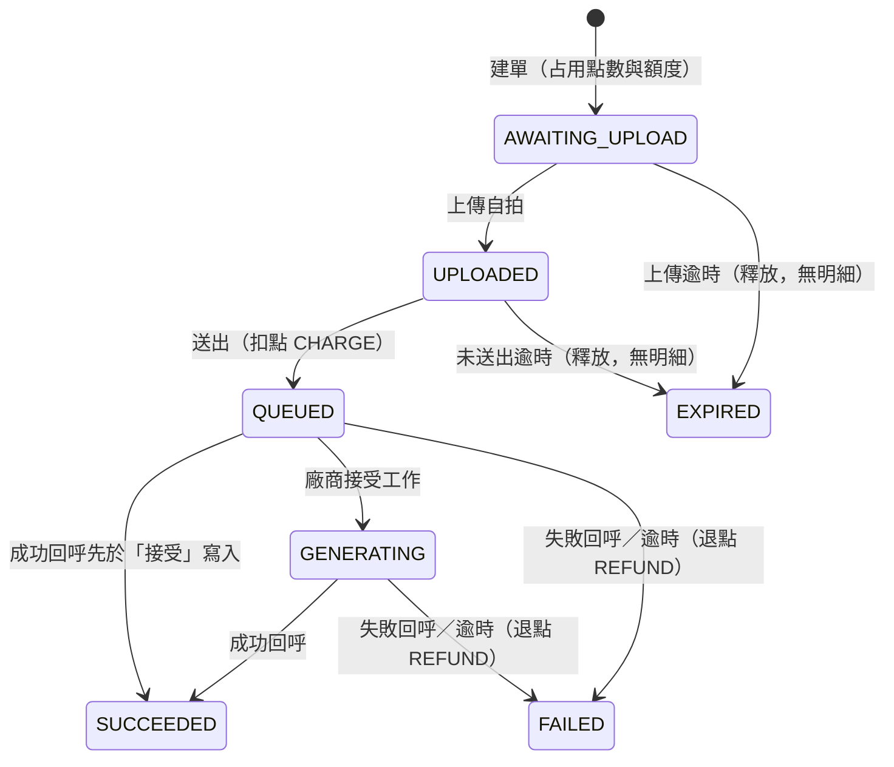

# 客串短劇：規格

> 狀態：MVP 已完成。本文件描述設計與規則；實作與驗證狀態見 [`VERIFICATION.md`](VERIFICATION.md)，畫面行為見 [`spec-mobile.md`](spec-mobile.md) 第 2 章；只寫文件、未實作的部分在文中標明。

## 1. 問題定義

讓觀眾放心付點數、交出自己的臉、放著長時間的工作不管。即使網路、App 或廠商出事，點數也不會算錯，結果拿得到，分享與否由觀眾決定。

三個難題：

1. 跨不可靠環節的點數正確性（App、網路、後端、廠商之間，任一段都可能中斷或重送）。
2. 工作時間長於 App 生命週期（上傳、生成要數分鐘，App 可能被切到背景或終止）。
3. App 守不住的規則與責任劃分（例如每日上限、浮水印、分享權限，不能交給可被改造的 App）。

## 2. 範圍決定

- 不做取消訂單（可能被洗）。
- 中斷後從步驟接續；照片整檔重傳（位元組續傳列 backlog，見 `BACKLOG.md`）。
- 只有相機入口，上傳的是 JPEG 照片（影片不適用）；後端只收 JPEG，以內容前 3 bytes（`FF D8 FF`）判斷、不看 `Content-Type`，不驗證照片來源；裝置驗證（例如平台完整性檢查）只寫文件。
- App 上傳成功後刪除本機照片；後端訂單結束後刪除自拍，只留浮水印成品。
- 範例影片（模擬環境）：repo 放一支固定的範例影片，所有 `SUCCEEDED` 訂單共用，App 由 `GET /v1/cameos/{id}/video` 取得，分享頁由免登入的 `GET /s/{token}/video` 取得，都播這一支；分享已取消或不存在時，後者回 JSON `404`。不轉檔、不加浮水印、不分訂單產生；範例影片檔案為 `backend/assets/sample.mp4`，畫面是程式產生的動態漸層和 `Cameo sample video` 字樣，沒有第三方素材；範例影片視為成品，正式環境的做法寫在 `ARCHITECTURE.md`。`vendor-sim` 回呼的 `video_url` 只是字串，不提供實際檔案。
- 「我的客串」（PDF 第 4 點，必做）：是 App 首頁，列出所有生成過的短片與狀態（含 `display` 文字），後端 `GET /v1/cameos?cursor=` 游標分頁；`video_available` 為 true 的列可點進影片頁播放與分享；點完成通知回首頁並刷新、不定位單筆。回前景刷新：依 id 合併第一頁，就地更新既有項目、新項目放最前、保留已載入項目與游標；第一頁和現有列表完全沒有重疊時整份取代，這時位置可能改變；刷新失敗不清空列表。已知代價：已載入但不在第一頁的項目不會被更新；不在前景的頁面不輪詢；回前景或資料更新時，若列表頂端在畫面上（只露出一部分也算），而且出現新訂單或待處理列增加，列表自動捲回頂端；列表頂端不在畫面上時不捲動、位置不變，並在底部置中顯示「回到頂端」（列表頂端離開畫面就出現、看得到就消失，點擊回到列表頂端），看到的是最近一次查詢結果。
- 登入與使用者：假設已用一個測試帳號登入。片段清單與初始點數由模擬後端提供，App 沒有假資料層。

## 3. 額度

- 每人每日上限 N = 3，設定值 `DAILY_LIMIT`（不寫死在畫面或業務程式碼）。
- 以台北時間計算，建單時占用。
- 失敗或過期退額度；`CONTENT_REJECTED` 退點不退額度。
- API 路徑使用 `/v1` 前綴。

`GET /v1/quota` 回應：

```json
{"remaining":2,"resets_at":"2026-11-07T00:00:00+08:00","display":"今日還可客串 2 次"}
```

App 行為：

- `remaining > 0`：片段清單顯示 `display`。
- `remaining = 0`：清單上方顯示已用完與重置時間；片段仍可點，點了跳提示，不進確認支付、不建單；未完成的客串不受影響。
- 建單遇 `429`：顯示後端 `message` 並重新查詢 quota。
- 與訂單同步時機一起查（開啟 App、回前景），建單後也查。
- 額度顯示在選片段頁，重新客串也做同樣檢查。

測試項目：建單減少、失敗／過期恢復、內容拒絕不恢復、台北午夜重置。

## 4. 點數

- 建單占用：可用點數減、占用點數增，不寫明細。
- 送出時同一交易扣點並寫 `CHARGE` 明細；送出可重複呼叫（冪等）。
- 上傳階段過期：釋放占用，不寫明細。
- 送出後失敗：退點並寫 `REFUND` 明細。
- 送出晚於期限：回 `410`，不扣款。
- `GET /v1/points` 回 `{available, held}`，`available = balance - held`。
- 確認支付提示：確認前顯示「確認後會占用 N 點，送出後才扣款」；建單後顯示後端 `display`（「已占用 N 點，送出後才扣款」）。
- 訂單回傳 `points_state`：`HELD`、`CHARGED`、`REFUNDED`、`RELEASED`。
- 轉為終態、寫入退點／釋放占用、退還額度，都在同一個資料庫交易內完成。

金流要特別測的情境：送出和過期排程同時發生、重複送出只扣一次、占用中不能超額建單。

## 5. 狀態與顯示文字

訂單狀態（後端為事實來源）：



- `SUCCEEDED`、`FAILED`、`EXPIRED` 為終態，先到的為準，晚到或矛盾的回呼只記 log。
- 逾時後才收到成功回呼：維持 `FAILED`，只記 log；最終狀態不可變更。
- 上傳期限 1 小時、生成期限程式預設 30 分鐘，compose 預設 2 分鐘。理由：縮短點數被占用的時間；代價：離線太久要重新建單。
- 分享狀態獨立於此狀態機，且只有 `SUCCEEDED` 能分享。

顯示文字：

| 狀態 | 文字 |
|---|---|
| `AWAITING_UPLOAD` | 標題「等待上傳」，說明「已占用 N 點，送出後才扣款」 |
| `EXPIRED` | 標題「已過期」，說明「上傳期限已過，點數沒有扣款，請重新客串。」 |
| `UPLOADED` | 標題「送出中」，說明「照片已上傳，尚未扣款」 |
| `QUEUED` | 標題「排隊中」，說明「完成後會通知你」 |
| `GENERATING` | 標題「生成中」，說明「完成後會通知你」 |
| `SUCCEEDED` | 標題「已完成」，說明「你的客串短片完成了」 |
| `FAILED`，原因 `CONTENT_REJECTED` | 標題「無法生成」，說明「照片未通過審核，點數已退還，今日次數不退還」 |
| 其他 `FAILED`（`VENDOR_FAILED`、`TIMEOUT`） | 標題「生成失敗」，說明「點數已退還」 |

不向使用者提示廠商故障。未知狀態用通用文字「處理中」。

`failure_reason`：`CONTENT_REJECTED`（退點、不退額度，只有這個值不退額度）、`VENDOR_FAILED`（廠商回報失敗且原因不是 `CONTENT_REJECTED`）、`TIMEOUT`（生成期限到仍無結果）；後兩者退點也退額度。

## 6. WebSocket 與同步

- 以下到「事件只是提示」為止是 WebSocket 設計，只寫文件、不實作（使用者決定）；最後一條同步時機要實作。
- 若未來實作，建議 Go 使用 `github.com/coder/websocket`（實作前再確認，引入前須經專案負責人同意）。
- 端點 `GET /v1/events`。
- 只有一種事件：`{"type":"cameo_updated","cameo_id":"..."}`；App 忽略未知事件。
- 交易提交後才發出事件；連線清單放 `api` 記憶體。
- 事件只是提示，狀態一律以 API 為準。
- 打 API 同步的時機：開啟 App、回前景、回首頁；前景輪詢見 `spec-mobile.md` 第 2 章。

## 7. 背景完成通知

- 承諾：盡力在 App 位於背景時通知，沒辦法百分之百保證。前景服務不保證存活：強制停止、程序被殺時服務會消失（已實測），廠牌省電與低記憶體未測，也未在真機驗證。服務消失時收不到通知，回到 App 會查詢並補發。上傳或送出還沒成功就被中斷時，訂單不會自己繼續。回到 App 後，還原到進度頁會自動接續，失敗時按「重試」；從待處理列則按「繼續」；只扣一次。一直沒回來時不會生成、不會扣款，已建單的點數占到上傳期限才釋放（到期釋放未實測）；例外是送出請求已到後端、只是 App 沒收到回應，這時訂單仍會生成並扣款（API 37 模擬器實測 1 次：App 顯示錯誤，沒有重試，訂單照樣生成並扣款 1 次）。
- App 被終止：開啟（回到前景）時補發，且只發一次。對所有有 `cameoId` 的草稿查一次訂單：`SUCCEEDED`／`FAILED` 先刪本機草稿（原子，刪到才算認領）、認領成功就立刻發通知（每筆各自「認領＋通知」，包在不可取消的區塊內）；`QUEUED`／`GENERATING` 重新啟動前景服務追蹤；其他狀態與查詢失敗不動。前景服務到結束狀態也走同一個「先刪草稿、刪成功才發通知」流程，這是「只發一次」的唯一機制。
- 取捨：先刪再發。不會補發（少發，不重發）的情況：認領之後、發通知之前程序被殺（進程中止）；另有回前景判斷「通知可用」到實際認領之間使用者剛好關掉通知的極窄窗口，這時草稿已刪、不補發（讀碼推論，未實測）；協程取消不會少發，因為認領與通知在同一個不可取消區塊。通知不可用（見下方通知權限）時不刪草稿、不通知，等通知可用後開啟 App 再補發。
- 首頁入口的權限判斷不存持久的「已請求過」旗標：權限沒開時每次先向系統請求；收到拒絕後，依 `shouldShowRequestPermissionRationale` 決定說明原因或提供「前往設定」（Android 行為的模擬器觀察見 `spec-mobile.md` 第 3 章「通知權限」）。
- 未完成清單與結果入口：已送出的訂單在草稿刪除前就不列在未完成清單（條件見 `spec-mobile.md` 未完成列規則），結果在首頁「我的客串」。點完成通知一律回首頁（使用者決定）：不定位單筆；已在首頁時留在此頁並刷新。點通知時若正在相機、確認或進度頁，這些流程頁會結束；已按「確認支付」的提交由提交執行者繼續完成，不會中止，尚未提交的草稿從待處理區接續。
- 做法已定案：前景服務（`dataSync`）。App 在使用者按「確認支付」時（建單前）就啟動前景服務，提交成功後每 10 秒查訂單，完成時發本機通知；細節見 `spec-mobile.md` 第 2 章「提交期間的前景服務」（取捨見 `ARCHITECTURE.md` 第 8 節）。
- 通知權限：按 FAB、重新客串或尚未建單的「繼續」時，先檢查「通知可用」，再檢查相機。「通知可用」：`areNotificationsEnabled()` 為 true，**且**「生成結果」頻道的 importance 不是 `IMPORTANCE_NONE`（API 26+；頻道還沒建立視為可用）。首頁入口、回前景補發、前景服務發通知前都用同一個判斷。頻道被關（App 通知開著）時一律顯示「前往設定」提示、不跳權限對話框，`ACTION_APP_NOTIFICATION_SETTINGS` 導到 App 通知設定；其餘不可用時，API 33 以上每次先向系統請求，同意後繼續檢查，拒絕時留在首頁，系統還能詢問就說明原因，不能再詢問就顯示「前往設定」與「取消」，從設定回來要再按一次；API 32 以下直接顯示「前往設定」與「取消」。App 開啟時不主動請求；確認頁和進度頁不請求。
- 有 `cameoId` 的訂單（未完成清單的繼續、重試）不擋；還不確定是否建單的 `CREATE` 草稿（建單請求可能已到伺服器）在首頁按「繼續」時檢查，確認頁不再檢查。代價：通知關著時，這筆可能要等上傳期限才釋放點數。訂單進行中才關通知也不擋，這時收不到通知，草稿保留，開啟 App 時補發。通知關閉時保留的草稿，若訂單已送出（`QUEUED`、`GENERATING`、`SUCCEEDED`、`FAILED`）或查不到狀態但步驟是 `TRACK`，不在未完成清單上；這時也無法從首頁開始新客串，不會累積。查不到狀態且步驟不是 `TRACK` 時仍會列出，顯示「暫時無法取得狀態」，沒有按鈕，查到狀態後依狀態決定是否列出。
- 代價：拒絕通知的人完全不能用客串功能。原因：讓進度頁「完成後會通知你」與本節承諾成立（使用者決定）。
- 後端靠廠商 webhook 得知結果；正式推播服務只寫文件，不實作。

## 8. 異常

實作 6 種（由 debug API 觸發）：

| 名稱 | 說明 |
|---|---|
| `response_lost_after_commit` | 交易提交後回應遺失 |
| `upload_interrupted` | 上傳中斷 |
| `upload_expired` | 上傳期限已過 |
| `vendor_failed` | 廠商回報失敗 |
| `vendor_duplicate_callback` | 廠商重複回呼 |
| `vendor_no_callback` | 廠商不回呼 |

只寫文件、不實作（7 種）：`socket_event_lost`、`upgrade_required`、`server_error`、`slow_network`、`vendor_dispatch_error`、`vendor_out_of_order`、`unknown_status`。

registry 放 adapter 層，提供 debug API。異常用 `GET/POST/DELETE /debug/faults` 設定；`backend/faults/*.json` 每種異常一個檔案，只當 `curl -d @...` 的 body，後端不載入，檔名是異常名稱把底線改成連字號再加 `.json`（例如 `backend/faults/response-lost-after-commit.json`）；另提供 `POST /debug/reset`（清空訂單與異常，重設點數與額度）；另有網頁控制台 `GET /debug/console`（登記、清空、重設異常與看狀態；只在 `DEBUG_API_ENABLED=true` 時開放）。細節見 `API.md`「Debug 異常 API」與 spec-server.md 第 7 節。

## 9. Backlog

見 `BACKLOG.md`。
