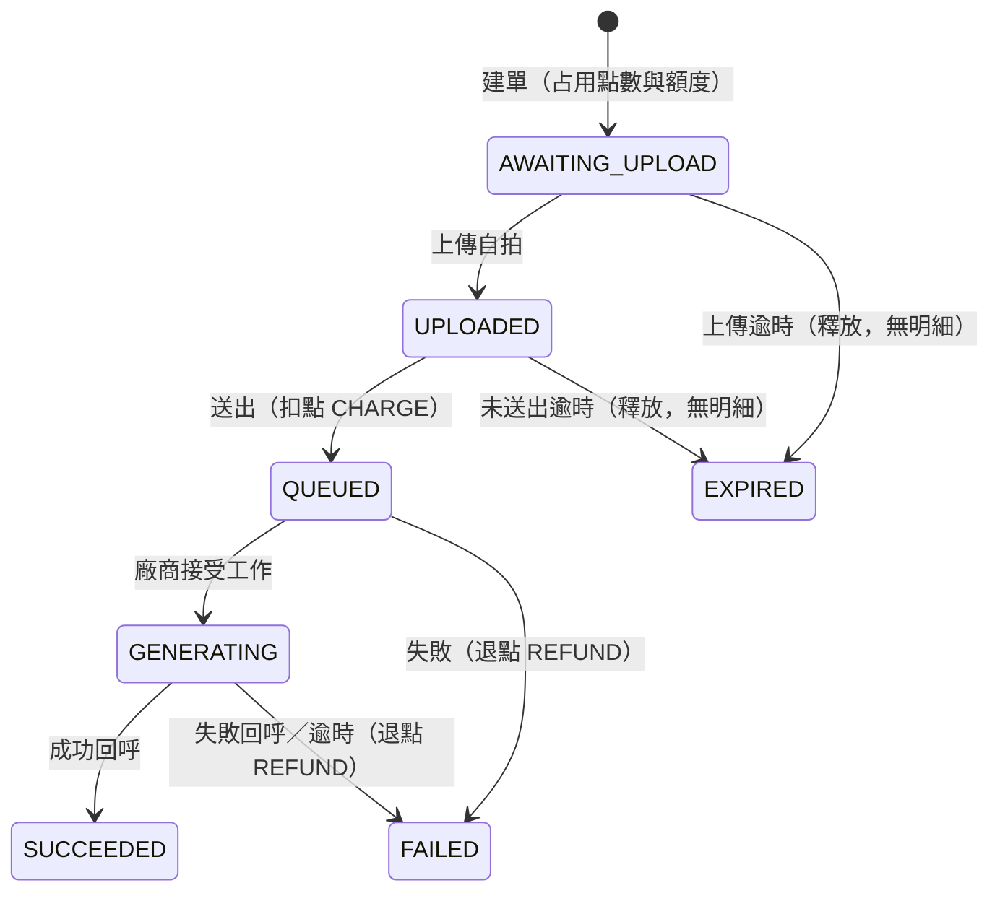

# 客串短劇：規格

> 狀態：進行中。本文件描述「將實作」的內容；第 2 輪的片段、點數、點數明細已實作並驗證（API 37 模擬器）；第 3 輪後端的建單、額度、逾期釋放已實作；第 4 輪後端的上傳自拍、送出（扣點、寫 `CHARGE` 明細）已實作並以真實 Postgres 與 Docker 驗證，App 尚未接上；App 的額度顯示、確認支付、本機草稿已在 API 37 模擬器接真實後端驗證（含已建單再點同片段拿新 key、CREATE 草稿重用同 key；確認時 `401` 未在模擬器驗證，只由單元測試涵蓋；「請求已到伺服器但 App 沒收到回應」以 curl 先送同 key 模擬，非真實斷線；其他例外與未驗項目見 `docs/manual-test-checklist.md` 第 3 輪）。其餘（App 的拍照、上傳、送出、通知、訂單清單）尚未實作。設計由討論決定。推論出、尚未確認的理由標 `[待確認]`。

## 1. 問題定義

讓觀眾放心付點數、交出自己的臉、放著長時間的工作不管。即使網路、App 或廠商出事，點數也不會算錯，結果拿得到，分享與否由觀眾決定。

三個難題：

1. 跨不可靠環節的點數正確性（App、網路、後端、廠商之間，任一段都可能中斷或重送）。
2. 工作時間長於 App 生命週期（上傳、生成要數分鐘，App 可能被切到背景或終止）。
3. App 守不住的規則與責任劃分（例如每日上限、浮水印、分享權限，不能交給可被改造的 App）。

## 2. 範圍決定

- 不做取消訂單（可能被洗）。
- 中斷後從步驟接續；照片整檔重傳（位元組續傳列 backlog，見第 12 節）。
- 只有相機入口，上傳的是 JPEG 照片（影片不適用）；後端只收 JPEG，以內容前 3 bytes（`FF D8 FF`）判斷、不看 `Content-Type`，不驗證照片來源；裝置驗證（例如平台完整性檢查）只寫文件。
- App 上傳成功後刪除本機照片；後端訂單結束後刪除自拍，只留浮水印成品。
- 登入與使用者：假設已用一個測試帳號登入。片段清單與初始點數由模擬後端提供，App 沒有假資料層。

## 3. 額度

- 每人每日上限 N = 3，設定值 `DAILY_LIMIT`（不寫死在畫面或業務程式碼）。
- 以台北時間計算，建單時占用。
- 失敗或過期退額度；`CONTENT_REJECTED` 退點不退額度。
- API 路徑使用 `/v1` 前綴。

`GET /v1/quota` 回應：

```json
{"remaining":2,"resets_at":"2026-11-07T00:00:00+08:00","display":"今日還可客串 2 次"}
```

App 行為：

- `remaining > 0`：片段清單顯示 `display`。
- `remaining = 0`：清單上方顯示已用完與重置時間；片段仍可點，點了跳提示，不進確認支付、不建單；未完成的客串不受影響。
- 建單遇 `429`：顯示後端 `message` 並重新查詢 quota。
- 與訂單同步時機一起查（開啟 App、回前景、收到提醒、重連），建單後也查。

測試項目：建單減少、失敗／過期恢復、內容拒絕不恢復、台北午夜重置。

## 4. 點數

- 建單占用：可用點數減、占用點數增，不寫明細。
- 送出時同一交易扣點並寫 `CHARGE` 明細；送出可重複呼叫（冪等）。
- 上傳階段過期：釋放占用，不寫明細。
- 送出後失敗：退點並寫 `REFUND` 明細。
- 送出晚於期限：回 `410`，不扣款。
- `GET /v1/points` 回 `{available, held}`，`available = balance - held`。
- 確認支付提示：確認前顯示「確認後會占用 N 點，送出後才扣款」；建單後顯示後端 `display`（「已占用 N 點，送出後才扣款」）。
- 訂單回傳 `points_state`：`HELD`、`CHARGED`、`REFUNDED`、`RELEASED`。
- 轉為終態、寫入退點／釋放占用、退還額度，都在同一個資料庫交易內完成。

金流要特別測的情境（第 3、4 輪實作）：送出和過期排程同時發生、重複送出只扣一次、占用中不能超額建單。

## 5. 狀態與顯示文字

訂單狀態（後端為事實來源）：



- `SUCCEEDED`、`FAILED`、`EXPIRED` 為終態，先到的為準，晚到或矛盾的回呼只記 log。
- 逾時後才收到成功回呼：維持 `FAILED`，只記 log；最終狀態不可變更。
- 上傳期限 1 小時、生成期限 30 分鐘。理由：縮短點數被占用的時間；代價：離線太久要重新建單。
- 分享狀態獨立於此狀態機，且只有 `SUCCEEDED` 能分享。

顯示文字：

| 狀態 | 文字 |
|---|---|
| `AWAITING_UPLOAD` | 標題「等待上傳」，說明「已占用 N 點，送出後才扣款」 |
| `EXPIRED` | 標題「已過期」，說明「上傳期限已過，點數沒有扣款，請重新客串。」 |
| `UPLOADED` | 標題「送出中」，說明「照片已上傳，尚未扣款」 |
| `QUEUED` | 標題「排隊中」，說明「完成後會通知你」 |
| `GENERATING` | 標題「生成中」，說明「完成後會通知你」 |

不向使用者提示廠商故障。其他狀態（`SUCCEEDED`、`FAILED`）的文字：`[待確認]`，在確認前後端回通用文字「處理中」。

## 6. WebSocket 與同步

- 建議 Go 使用 `github.com/coder/websocket`（實作前再確認，引入前須經專案負責人同意）。
- 端點 `GET /v1/events`。
- 只有一種事件：`{"type":"cameo_updated","cameo_id":"..."}`；App 忽略未知事件。
- 交易提交後才發出事件；連線清單放 `api` 記憶體。
- 事件只是提示，狀態一律以 API 為準。
- 打 API 同步的時機：開啟 App、回前景、收到提醒、重連成功、前景有未結束訂單時每 30 秒。

## 7. 背景完成通知

- 承諾：App 在背景且未被強制停止時收到通知。
- App 被終止：開啟時補發，且只發一次。
- 具體做法待第 5 輪驗證後定案。
- 後端靠廠商 webhook 得知結果；正式推播服務只寫文件，不實作。

## 8. 異常

實作 8 種（由 debug API 觸發）：

| 名稱 | 說明 |
|---|---|
| `response_lost_after_commit` | 交易提交後回應遺失 |
| `upload_interrupted` | 上傳中斷 |
| `upload_expired` | 上傳期限已過 |
| `vendor_failed` | 廠商回報失敗 |
| `vendor_duplicate_callback` | 廠商重複回呼 |
| `vendor_no_callback` | 廠商不回呼 |
| `socket_event_lost` | WebSocket 事件遺失 |
| `upgrade_required` | 需要強制更新 |

只寫文件、不實作：`server_error`、`slow_network`、`vendor_dispatch_error`、`vendor_out_of_order`、`unknown_status`。

registry 放 adapter 層，提供 debug API。異常用 JSON 情境檔（`backend/faults/*.json`）和 `GET/POST/DELETE /debug/faults` 觸發；另提供 `POST /debug/reset`（清空訂單與異常，重設點數與額度）；不做 console 網站。各異常的預期表現與參數：待實作後補。

## 9. 技術基礎

- 後端：Go、Docker、Postgres、`vendor-sim`（模擬廠商）。
- Android：Kotlin、Jetpack Compose、Hilt、Room、KSP、WorkManager、OkHttp／Retrofit、CameraX、Media3。
- App 與後端都走 Clean Architecture。
- 廠商 webhook 以 HMAC 驗簽；所有會重送的操作做冪等。

硬性限制：

- 乾淨電腦用一行指令啟動後端，照 README 在模擬器上執行 App。
- 不依賴個人帳號、金鑰或 Firebase。
- 設定值（後端網址等）不寫死在畫面。
- 關鍵邏輯的測試不需啟動 App。
- 實作一個平台（Android），設計涵蓋 iOS 與 Android。

## 10. App 架構

模組 `:domain` / `:data` / `:app`：

- `:domain`：視為未來可獨立成 repo 的 submodule。只依賴 Kotlin 標準庫和 coroutines，放 usecase、repository 介面與模型；無 `@Inject`；可獨立建置與測試；不用 `java.*`。
- `:data`：實作預設 `internal`，依功能分資料夾。
- `:app`：只放 View／ViewModel、組裝（Hilt）、平台實作。

工具鏈（iteration 2 已建置並跑過單元測試與 API 37 模擬器）：Gradle 9.5.0、AGP 9.3.1、Kotlin 2.2.10、Compose BOM 2026.06.01、compileSdk 37、targetSdk 36（多個 AndroidX／OkHttp 依賴要求 compileSdk 至少 37；targetSdk 用 36 的原因見 `ARCHITECTURE.md` 第 8 節）、minSdk 26、JDK 21 toolchain（foojay 自動下載）。Hilt 2.60.1、Room 2.8.5、KSP 2.3.13 可與上述版本一起建置。`kotlinx-serialization` 用 1.9.0：1.12.0 的 metadata 版本高於 Kotlin 2.2.10 編譯器可讀，無法編譯。`kotlin-stdlib` 實際由依賴解析到 2.3.21，`kotlinx-serialization` 維持 1.9.0。

驗收：`:domain` 能獨立建置與測試；`:app` 無法直接使用 `:data` 的實作；Hilt 綁定可建置。

做法：模組邊界、純模型、規則集中、狀態機測試、手動驗證清單。

### Room `pending_cameos`

每次客串一列：

| 欄位 | 說明 |
|---|---|
| `client_request_id` | 主鍵／冪等鍵 |
| `clip_id` | 片段 |
| `cameo_id` | 建單後取得 |
| `step` | `CREATE`、`UPLOAD`、`SUBMIT`、`TRACK` |
| `photo_path` | 照片在私有目錄；上傳成功刪檔並清空 |
| `last_error` | 最近一次錯誤 |
| `updated_at` | 更新時間 |

訂單結束且通知發出後，在同一交易刪除該列（列不存在即已通知）。點數、額度、訂單狀態、片段、明細不放 Room。

建單失敗時草稿的處理：

| 錯誤 | 此 key 有訂單嗎 | 草稿 | 畫面 |
|---|---|---|---|
| `402`、`429`、`404 CLIP_NOT_FOUND` | 確定沒有（後端查過冪等鍵才回） | 刪除 | 顯示訊息，回片段清單 |
| `5xx`、網路錯誤、回應遺失 | 不確定 | 保留 | 顯示「重試」，用同一個 key |
| 其他 `retryable=false`（`400`、`401`、`409`、`426`、非 JSON 4xx） | 不確定 | 保留並記錄錯誤 | 顯示訊息，不顯示重試；未完成列可「繼續」（同一個 key）或「移除」 |

移除後，如果該 key 其實已建單，訂單只占用點數與當日額度、沒有扣款，由後端在上傳期限後釋放。

## 11. 後端架構

目錄：`backend/internal/{domain,usecase,adapter/{http,postgres,filestore,vendor,realtime},app}`，`cmd` 負責組裝；測試用的整合測試與資料庫工具在 `backend/test`。以 Go 測試檢查 import 方向。`vendor-sim` 不套分層。

Port 定義在 `usecase`：`TxRunner`、`Tx`、`Queries`、`FileStore`、`VendorClient`、`EventPublisher`、`Clock`。

```go
type TxRunner interface {
    Run(ctx context.Context, fn func(tx Tx) error) error
}
```

`FileStore`（自拍檔案）已實作於 `adapter/filestore`（存本機目錄 `SELFIE_DIR`，Docker 以 named volume 掛載；暫存檔與正式檔在同一個檔案系統，用 rename 原子覆蓋）：

```go
type FileStore interface {
    WriteTemp(ctx context.Context, r io.Reader) (tempName string, err error)
    Commit(tempName, cameoID string) error // 原子 rename，覆蓋舊檔
    Discard(tempName string) error
    Delete(cameoID string) error           // 不存在不算錯
}
```

上傳流程：先查訂單擋掉明顯不能上傳的 → 串流寫暫存檔 → 交易內鎖列、重查狀態與期限、更新狀態並 rename → commit；訂單轉 `EXPIRED` 的交易 commit 後才刪檔，刪除失敗只記 log。送出同一交易內固定先鎖點數帳戶、再鎖訂單列。逾期判斷（`upload_expires_at <= now`）掃描、上傳、送出共用同一條 SQL 規則。

測試：金流用真實 Postgres；domain 用純 Go 測試；廠商和 WebSocket 用 fake。

## 12. Backlog

- 位元組續傳。
- 自拍 checksum（X-Content-SHA256、422）：目前靠 Content-Length 發現截斷並整檔重傳，先不做。
- access token／refresh token：MVP 假設已登入、使用固定測試 token，沒有登入畫面；做完 MVP 再評估。
- 離線優先：快取只用於顯示，事實來源仍是後端 API；離線時標示更新時間；不憑快取判斷能否建單。
- 自拍儲存的崩潰一致性：rename 後當機未 fsync 目錄可能遺失檔案；掃描 commit 後、刪檔前當機，EXPIRED 訂單的檔案不會再被刪。MVP 只記錄，不處理。

## 13. Iteration

每輪都做後端與 App，文件更新列入驗收。

| # | 內容 | 預估 |
|---|---|---|
| 1 | `spec.md`、`ARCHITECTURE.md` 骨架、README API | 30 分 |
| 2 | Docker、分層骨架、Hilt、片段／點數／明細 | 2.5 小時 |
| 3 | 建單占用、冪等、上限、quota、確認支付、本機草稿 | 1 小時 |
| 4 | 拍照上傳、送出扣點、接續 | 1.5 小時 |
| 5 | 回呼退點、進度、背景通知（先實測通知與背景 socket） | 上限 4 小時 |
| 6 | WebSocket | 1 小時 |
| 7 | 播放、分享、強制更新 | 1 小時 |
| 8 | 8 種異常模擬器驗證、README | 1.5 小時 |
| 9 | 文件定稿、全新 clone 總驗收 | 2 小時 |

排程：11/06：1–2；11/07：3–5；11/08：6–8；11/09：9、演練。

落後時依序砍：

1. 第 7 輪的強制更新只寫文件。
2. 第 8 輪只驗 3 種金流異常。
3. 第 6 輪的 WebSocket（需專案負責人同意）。

不砍第 3、4、5 輪。

## 14. 主要待確認項目

- 後端使用 Go 的理由：專案負責人自述的理由，內容 `[待確認]`。
- 背景完成通知的具體做法：第 5 輪驗證後定案（見第 7 節）。
- 除 `QUEUED`、`GENERATING` 外的狀態顯示文字。
- 分享連結（token）的細節、`failure_reason` 完整清單：見 README，皆標 `[待確認]`。
