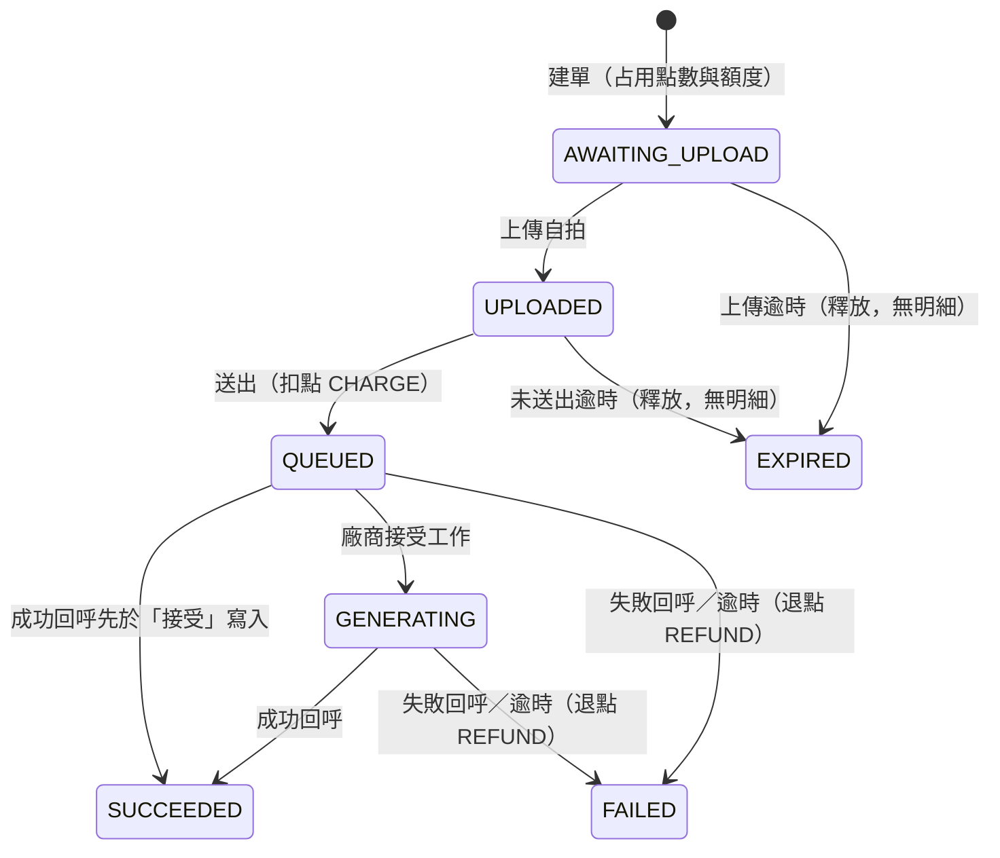

# 客串短劇：規格

> 狀態：進行中。本文件描述「將實作」的內容；第 2 輪的片段、點數、點數明細已實作並驗證（API 37 模擬器）；第 3 輪後端的建單、額度、逾期釋放已實作；第 4 輪後端的上傳自拍、送出（扣點、寫 `CHARGE` 明細）已實作並以真實 Postgres 與 Docker 驗證；App 端的上傳與送出（4.3：進度畫面、依後端狀態接續、失敗重試）已接上，並在 4.4 於 API 37 模擬器接真實後端驗證主流程與接續情境（上傳途中進背景、真實斷線、`401`、真機未驗；確認頁返回轉場中點「確認支付」修正前會建單，已加 `dropUnlessResumed` 只擋「頁面已在離開中」的點擊，修正後 7 次未建單（d=0.7 點到清單列、沒打到按鈕；d=0.5 沒有修正前對照；可直接對照的是 d=0、0.05、0.1、0.2、0.3 這 5 個值，每個 d 只跑 1 次），但不是完整解法：先按確認再按返回時，回應在頁面銷毀後才回來只占用（按「繼續」或等期限釋放），在淡出期間回來則照常上傳、送出、扣款（MVP 決定，見 `ARCHITECTURE.md` 取捨表；皆為讀碼推論、未實測），見第 4 輪 Integration 紀錄）；App 的額度顯示、確認支付、本機草稿已在 API 37 模擬器接真實後端驗證（含已建單再點同片段拿新 key、CREATE 草稿重用同 key；確認時 `401` 未在模擬器驗證，只由單元測試涵蓋；「請求已到伺服器但 App 沒收到回應」以 curl 先送同 key 模擬，非真實斷線；其他例外與未驗項目見第 3 輪紀錄）。第 4 輪 App 的拍照（CameraX 前鏡頭拍照、預覽、重拍、確認支付時把照片移入 `filesDir/selfies`）已在 API 37 模擬器驗證（相機為模擬器虛擬相機；相機權限拒絕與設定返回、旋轉、強制停止、草稿續拍、逾期清檔見第 4 輪紀錄）。第 5.1 輪後端（派工給 `vendor-sim`、廠商 webhook、生成逾時、失敗退點與退額度）已實作並以後端測試與 curl 驗證（App 尚未接上，見第 5.1 輪紀錄）。App 的生成進度畫面、前景服務與完成通知（第 5.2 輪）、確認支付前的通知權限檢查、回到前景的補發與恢復追蹤已實作（單元測試涵蓋，模擬器實測排在 5.3）；App 的「我的客串」頁已實作（第 5.2b-2 輪，見該輪紀錄）；點完成通知開「我的客串」分頁已實作（第 5.2b-3 輪，模擬器最小冒煙，見該輪紀錄）。設計由討論決定。推論出、尚未確認的理由標 `[待確認]`。App 資訊架構改版的規格已定，尚未實作，見 `spec-mobile.md` 第 2 章。文中「第 N 輪紀錄」指 `git show 8ca2c96:docs/manual-test-checklist.md` 的對應段落。

## 1. 問題定義

讓觀眾放心付點數、交出自己的臉、放著長時間的工作不管。即使網路、App 或廠商出事，點數也不會算錯，結果拿得到，分享與否由觀眾決定。

三個難題：

1. 跨不可靠環節的點數正確性（App、網路、後端、廠商之間，任一段都可能中斷或重送）。
2. 工作時間長於 App 生命週期（上傳、生成要數分鐘，App 可能被切到背景或終止）。
3. App 守不住的規則與責任劃分（例如每日上限、浮水印、分享權限，不能交給可被改造的 App）。

## 2. 範圍決定

- 不做取消訂單（可能被洗）。
- 中斷後從步驟接續；照片整檔重傳（位元組續傳列 backlog，見第 12 節）。
- 只有相機入口，上傳的是 JPEG 照片（影片不適用）；後端只收 JPEG，以內容前 3 bytes（`FF D8 FF`）判斷、不看 `Content-Type`，不驗證照片來源；裝置驗證（例如平台完整性檢查）只寫文件。
- App 上傳成功後刪除本機照片；後端訂單結束後刪除自拍，只留浮水印成品。（App 端 4.3 已實作，只有單元測試，尚未在模擬器驗證。）
- 範例影片（模擬環境）：repo 放一支固定的範例影片，所有 `SUCCEEDED` 訂單共用，App 由 `GET /v1/cameos/{id}/video` 取得，分享頁由免登入的 `GET /s/{token}/video` 取得，都播這一支（影片檔、`GET /v1/cameos/{id}/video` 與 `GET /s/{token}/video` 都已完成）；分享已取消或不存在時，後者回 JSON `404`。不轉檔、不加浮水印、不分訂單產生；範例影片檔案為 `backend/assets/sample.mp4`，畫面上有 `…IMHIT CAMEO WATERMAR…`、`…AMPLE - NOT FOR REUSE` 字樣（兩端被裁切，照原樣記錄），分享頁會顯示這些字，先沿用，測試發現問題再換；來源與授權未確認；範例影片視為成品，正式環境的做法寫在 `ARCHITECTURE.md`。`vendor-sim` 回呼的 `video_url` 只是字串，不提供實際檔案。
- 「我的客串」（PDF 第 4 點，必做）：列出所有生成過的短片與狀態（含 `display` 文字）。排在第 5.2b 階段（第 5.3 之前）：後端 `GET /v1/cameos?cursor=`、App「我的客串」頁、點通知開這一頁；第 7 輪在此頁加播放和分享入口。目前後端 `GET /v1/cameos?cursor=` 已實作（5.2b-1）；App「我的客串」頁已實作（5.2b-2：底部導覽第三分頁、游標分頁、每次回到前景靜默刷新第一頁，列不可點）；點完成通知開此頁已實作（5.2b-3：只切到分頁、不定位單筆）。回前景刷新（H2 已實作，單元測試涵蓋，模擬器實測排在 H9）：依 id 合併第一頁，就地更新既有項目、新項目放最前、保留已載入項目與游標；第一頁和現有列表完全沒有重疊時整份取代，這時位置可能改變；刷新失敗不清空列表。已知代價：已載入但不在第一頁的項目不會被更新；不在前景的頁面不輪詢；回前景或資料更新時，若第一筆在畫面上（只露出一部分也算）而且出現新的第一筆，列表自動捲到新的第一筆；第一筆不在畫面上時不捲動、位置不變，並在右下角顯示「回到頂端」（第一筆離開畫面就出現、看得到就消失，點擊回到第一筆），看到的是最近一次查詢結果。
- 列表依 id 合併已實作（H2）；「我的客串」成為首頁的改版尚未實作，見 `spec-mobile.md` 第 2 章。
- 登入與使用者：假設已用一個測試帳號登入。片段清單與初始點數由模擬後端提供，App 沒有假資料層。

## 3. 額度

- 每人每日上限 N = 3，設定值 `DAILY_LIMIT`（不寫死在畫面或業務程式碼）。
- 以台北時間計算，建單時占用。
- 失敗或過期退額度；`CONTENT_REJECTED` 退點不退額度。
- API 路徑使用 `/v1` 前綴。

`GET /v1/quota` 回應：

```json
{"remaining":2,"resets_at":"2026-11-07T00:00:00+08:00","display":"今日還可客串 2 次"}
```

App 行為：

- `remaining > 0`：片段清單顯示 `display`。
- `remaining = 0`：清單上方顯示已用完與重置時間；片段仍可點，點了跳提示，不進確認支付、不建單；未完成的客串不受影響。
- 建單遇 `429`：顯示後端 `message` 並重新查詢 quota。
- 與訂單同步時機一起查（開啟 App、回前景），建單後也查。
- 改版後這些額度顯示在選片段流程頁，重新客串也做同樣檢查；尚未實作，見 `spec-mobile.md` 第 2 章。

測試項目：建單減少、失敗／過期恢復、內容拒絕不恢復、台北午夜重置。

## 4. 點數

- 建單占用：可用點數減、占用點數增，不寫明細。
- 送出時同一交易扣點並寫 `CHARGE` 明細；送出可重複呼叫（冪等）。
- 上傳階段過期：釋放占用，不寫明細。
- 送出後失敗：退點並寫 `REFUND` 明細。
- 送出晚於期限：回 `410`，不扣款。
- `GET /v1/points` 回 `{available, held}`，`available = balance - held`。
- 確認支付提示：確認前顯示「確認後會占用 N 點，送出後才扣款」；建單後顯示後端 `display`（「已占用 N 點，送出後才扣款」）。
- 訂單回傳 `points_state`：`HELD`、`CHARGED`、`REFUNDED`、`RELEASED`。
- 轉為終態、寫入退點／釋放占用、退還額度，都在同一個資料庫交易內完成。

金流要特別測的情境（第 3、4 輪實作）：送出和過期排程同時發生、重複送出只扣一次、占用中不能超額建單。

## 5. 狀態與顯示文字

訂單狀態（後端為事實來源）：



- `SUCCEEDED`、`FAILED`、`EXPIRED` 為終態，先到的為準，晚到或矛盾的回呼只記 log。
- 逾時後才收到成功回呼：維持 `FAILED`，只記 log；最終狀態不可變更。
- 上傳期限 1 小時、生成期限程式預設 30 分鐘，compose 預設將改為 2 分鐘（尚未實作）。理由：縮短點數被占用的時間；代價：離線太久要重新建單。
- 分享狀態獨立於此狀態機，且只有 `SUCCEEDED` 能分享。

顯示文字：

| 狀態 | 文字 |
|---|---|
| `AWAITING_UPLOAD` | 標題「等待上傳」，說明「已占用 N 點，送出後才扣款」 |
| `EXPIRED` | 標題「已過期」，說明「上傳期限已過，點數沒有扣款，請重新客串。」 |
| `UPLOADED` | 標題「送出中」，說明「照片已上傳，尚未扣款」 |
| `QUEUED` | 標題「排隊中」，說明「完成後會通知你」 |
| `GENERATING` | 標題「生成中」，說明「完成後會通知你」 |
| `SUCCEEDED` | 標題「已完成」，說明「你的客串短片完成了」 |
| `FAILED`，原因 `CONTENT_REJECTED` | 標題「無法生成」，說明「照片未通過審核，點數已退還，今日次數不退還」 |
| 其他 `FAILED`（`VENDOR_FAILED`、`TIMEOUT`） | 標題「生成失敗」，說明「點數已退還」 |

不向使用者提示廠商故障。未知狀態用通用文字「處理中」。

`failure_reason`：`CONTENT_REJECTED`（退點、不退額度，只有這個值不退額度）、`VENDOR_FAILED`（廠商回報失敗且原因不是 `CONTENT_REJECTED`）、`TIMEOUT`（生成期限到仍無結果）；後兩者退點也退額度。

## 6. WebSocket 與同步

- 以下到「事件只是提示」為止是 WebSocket 設計，只寫文件、不實作（使用者決定）；最後一條同步時機要實作。
- 若未來實作，建議 Go 使用 `github.com/coder/websocket`（實作前再確認，引入前須經專案負責人同意）。
- 端點 `GET /v1/events`。
- 只有一種事件：`{"type":"cameo_updated","cameo_id":"..."}`；App 忽略未知事件。
- 交易提交後才發出事件；連線清單放 `api` 記憶體。
- 事件只是提示，狀態一律以 API 為準。
- 打 API 同步的時機：開啟 App、回前景、回首頁；前景輪詢見 `spec-mobile.md` 第 2 章。

## 7. 背景完成通知

- 承諾：App 在背景且未被強制停止時收到通知。
- App 被終止：開啟（回到前景）時補發，且只發一次（已實作，單元測試涵蓋，模擬器實測排在 5.3）。對所有有 `cameoId` 的草稿查一次訂單：`SUCCEEDED`／`FAILED` 先刪本機草稿（原子，刪到才算認領）、認領成功就立刻發通知（每筆各自「認領＋通知」，包在不可取消的區塊內）；`QUEUED`／`GENERATING` 重新啟動前景服務追蹤；其他狀態與查詢失敗不動。前景服務到結束狀態也走同一個「先刪草稿、刪成功才發通知」流程，這是「只發一次」的唯一機制。
- 取捨：先刪再發。不會補發（少發，不重發）的情況：認領之後、發通知之前程序被殺（進程中止）；另有回前景判斷「通知可用」到實際認領之間使用者剛好關掉通知的極窄窗口，這時草稿已刪、不補發（讀碼推論，未實測）；協程取消不會少發，因為認領與通知在同一個不可取消區塊。通知不可用（見下方通知權限）時不刪草稿、不通知，等通知可用後開啟 App 再補發。
- 權限旗標：「已請求過」旗標在收到權限結果時寫入，對話框被取消（dismiss）時也會寫入，之後走「前往設定」路徑（Android 行為為推論，未實測）。
- 未完成清單與結果入口：已送出的訂單在草稿刪除前就不列在未完成清單（條件見 `spec-mobile.md` 未完成列規則），結果由「我的客串」頁提供（5.2b-2 已實作）；點完成通知會開到「我的客串」分頁（5.2b-3 已實作）：只開到分頁、不定位單筆；已在此分頁時留在此頁並刷新。點通知一律開「我的客串」（使用者決定）。前景在相機、確認、進度頁時，這些流程頁會結束，等同離開該頁，進行中的上傳或建單會中止，之後從未完成列接續（接續未實測，排 5.3）。
- 做法已定案：前景服務（`dataSync`）。App 在送出成功後啟動前景服務，每 10 秒查訂單，完成時發本機通知（取捨見 `ARCHITECTURE.md` 第 8 節）。
- 通知權限（已實作，單元測試涵蓋，模擬器實測排在 5.3）：按「確認支付」時、`POST /v1/cameos` 之前檢查「通知可用」：`areNotificationsEnabled()` 為 true，**且**「生成結果」頻道的 importance 不是 `IMPORTANCE_NONE`（API 26+；頻道還沒建立視為可用）。確認頁 gate、回前景補發、前景服務發通知前都用同一個判斷。通知可用就照常建單；頻道被關（App 通知開著）時一律顯示「前往設定」提示、不跳權限對話框，`ACTION_APP_NOTIFICATION_SETTINGS` 導到 App 通知設定；其餘不可用時，系統還能顯示對話框就請求，同意後重新檢查，通知可用才建單、頻道仍關就顯示提示，拒絕就停在確認頁不建單；系統不再顯示對話框時，顯示 App 自己的提示「需要開啟通知才能客串」（「前往設定」與「取消」），回來再按一次確認。App 開啟時不主動請求；進度頁不請求。
- 有 `cameoId` 的訂單（未完成清單的繼續、重試）不擋；還不確定是否建單的 `CREATE` 草稿（建單請求可能已到伺服器）會到確認頁並經過通知檢查。代價：通知關著時，這筆可能要等上傳期限才釋放點數。訂單進行中才關通知也不擋，這時收不到通知，草稿保留，開啟 App 時補發。通知關閉時保留的草稿，若訂單已送出（`QUEUED`、`GENERATING`、`SUCCEEDED`、`FAILED`）或查不到狀態但步驟是 `TRACK`，不在未完成清單上（H1 已實作，單元測試涵蓋，模擬器實測排在 H9）；這時也建不了新單，不會累積。查不到狀態且步驟不是 `TRACK` 時仍會列出，顯示「暫時無法取得狀態」，沒有按鈕，查到狀態後依狀態決定是否列出。
- 代價：拒絕通知的人完全不能用客串功能。原因：讓進度頁「完成後會通知你」與本節承諾成立（使用者決定）。
- 改版後，上面的確認頁通知檢查，以及 `CREATE` 草稿到確認頁的通知檢查，都改為在按 FAB、重新客串或尚未建單的「繼續」時檢查；有 `cameoId` 的訂單不擋不變。尚未實作，見 `spec-mobile.md` 第 2 章。
- 後端靠廠商 webhook 得知結果；正式推播服務只寫文件，不實作。

## 8. 異常

實作 6 種（由 debug API 觸發）：

| 名稱 | 說明 |
|---|---|
| `response_lost_after_commit` | 交易提交後回應遺失 |
| `upload_interrupted` | 上傳中斷 |
| `upload_expired` | 上傳期限已過 |
| `vendor_failed` | 廠商回報失敗 |
| `vendor_duplicate_callback` | 廠商重複回呼 |
| `vendor_no_callback` | 廠商不回呼 |

只寫文件、不實作（7 種）：`socket_event_lost`、`upgrade_required`、`server_error`、`slow_network`、`vendor_dispatch_error`、`vendor_out_of_order`、`unknown_status`。

registry 放 adapter 層，提供 debug API。異常用 `GET/POST/DELETE /debug/faults` 設定；`backend/faults/*.json` 每種異常一個檔案，只當 `curl -d @...` 的 body，後端不載入，檔名是異常名稱把底線改成連字號再加 `.json`（例如 `backend/faults/response-lost-after-commit.json`）；另提供 `POST /debug/reset`（清空訂單與異常，重設點數與額度）；不做 console 網站。登記、重設、開關，以及 `response_lost_after_commit`、`upload_interrupted`、`upload_expired` 的實際觸發已實作；`POST /debug/faults/consume` 和 `vendor_*` 3 種的實際觸發已定案、尚未實作，細節見 README「Debug 異常 API」與 spec-server.md 第 7 節。

## 9. 技術基礎

- 後端：Go、Docker、Postgres、`vendor-sim`（模擬廠商）。
- Android：Kotlin、Jetpack Compose、Hilt、Room、KSP、OkHttp／Retrofit、CameraX（`1.6.2`，`camera-core`、`camera-camera2`、`camera-lifecycle`、`camera-view`）、Media3。
- App 與後端都走 Clean Architecture。
- 廠商 webhook 以 HMAC 驗簽；所有會重送的操作做冪等。

硬性限制：

- 乾淨電腦用一行指令啟動後端，照 README 在模擬器上執行 App。
- 不依賴個人帳號、金鑰或 Firebase。
- 設定值（後端網址等）不寫死在畫面。
- 關鍵邏輯的測試不需啟動 App。
- 實作一個平台（Android），設計涵蓋 iOS 與 Android。

## 10. App 架構

模組 `:domain` / `:data` / `:app`：

- `:domain`：視為未來可獨立成 repo 的 submodule。只依賴 Kotlin 標準庫和 coroutines，放 usecase、repository 介面與模型；無 `@Inject`；可獨立建置與測試；不用 `java.*`。
- `:data`：實作預設 `internal`，依功能分資料夾。
- `:app`：只放 View／ViewModel、組裝（Hilt）、平台實作。

工具鏈（iteration 2 已建置並跑過單元測試與 API 37 模擬器）：Gradle 9.5.0、AGP 9.3.1、Kotlin 2.2.10、Compose BOM 2026.06.01、compileSdk 37、targetSdk 36（多個 AndroidX／OkHttp 依賴要求 compileSdk 至少 37；targetSdk 用 36 的原因見 `ARCHITECTURE.md` 第 8 節）、minSdk 26、JDK 21 toolchain（foojay 自動下載）。Hilt 2.60.1、Room 2.8.5、KSP 2.3.13 可與上述版本一起建置。`kotlinx-serialization` 用 1.9.0：1.12.0 的 metadata 版本高於 Kotlin 2.2.10 編譯器可讀，無法編譯。`kotlin-stdlib` 實際由依賴解析到 2.3.21，`kotlinx-serialization` 維持 1.9.0。

驗收：`:domain` 能獨立建置與測試；`:app` 無法直接使用 `:data` 的實作；Hilt 綁定可建置。

做法：模組邊界、純模型、規則集中、狀態機測試、手動驗證。

### Room `pending_cameos`

每次客串一列：

| 欄位 | 說明 |
|---|---|
| `client_request_id` | 主鍵／冪等鍵 |
| `clip_id` | 片段 |
| `cameo_id` | 建單後取得 |
| `step` | `CREATE`、`UPLOAD`、`SUBMIT`、`TRACK` |
| `photo_path` | 照片在私有目錄；上傳成功刪檔並清空；查到訂單為 `EXPIRED` 時也刪檔並清空（資料列保留，讓使用者看到過期並選擇重新客串或移除） |
| `last_error` | 最近一次錯誤 |
| `updated_at` | 更新時間 |

訂單結束（`SUCCEEDED`／`FAILED`）時先以單一 `DELETE ... WHERE cameo_id` 刪除該列（刪到 1 列才算認領），認領成功才發通知；刪列時一併刪本機照片。不是同一交易：通知發出前程序被殺，這則就不會補發。點數、額度、訂單狀態、片段、明細不放 Room。

建單失敗時草稿的處理：

| 錯誤 | 此 key 有訂單嗎 | 草稿 | 畫面 |
|---|---|---|---|
| `402`、`429`、`404 CLIP_NOT_FOUND` | 確定沒有（後端查過冪等鍵才回） | 刪除 | 顯示訊息，回片段清單 |
| `5xx`、網路錯誤、回應遺失 | 不確定 | 保留 | 顯示「重試」，用同一個 key |
| 其他 `retryable=false`（`400`、`401`、`409`、`426`、非 JSON 4xx） | 不確定 | 保留並記錄錯誤 | 顯示訊息，不顯示重試；未完成列可「繼續」（同一個 key）或「移除」 |

移除後，如果該 key 其實已建單，訂單只占用點數與當日額度、沒有扣款，由後端在上傳期限後釋放。

### App 畫面行為

見 `spec-mobile.md` 第 2 章，尚未實作。畫面行為只維護在那份文件。畫面行為有衝突時以該章為準。

## 11. 後端架構

目錄：`backend/internal/{domain,usecase,adapter/{http,postgres,filestore,vendor,realtime},app}`（`realtime` 只寫文件、不實作），`cmd` 負責組裝；測試用的整合測試與資料庫工具在 `backend/test`。以 Go 測試檢查 import 方向。`vendor-sim` 不套分層。

Port 定義在 `usecase`：`TxRunner`、`Tx`、`Queries`、`FileStore`、`VendorClient`、`EventPublisher`、`Clock`（`VendorClient` 已實作於 `adapter/vendor`；`EventPublisher` 只寫文件、不實作）。

```go
type TxRunner interface {
    Run(ctx context.Context, fn func(tx Tx) error) error
}
```

`FileStore`（自拍檔案）已實作於 `adapter/filestore`（存本機目錄 `SELFIE_DIR`，Docker 以 named volume 掛載；暫存檔與正式檔在同一個檔案系統，用 rename 原子覆蓋）：

```go
type FileStore interface {
    WriteTemp(ctx context.Context, r io.Reader) (tempName string, err error)
    Commit(tempName, cameoID string) error // 原子 rename，覆蓋舊檔
    Discard(tempName string) error
    Delete(cameoID string) error           // 不存在不算錯
}
```

上傳流程：先查訂單擋掉明顯不能上傳的 → 串流寫暫存檔 → 交易內鎖列、重查狀態與期限、更新狀態並 rename → commit；訂單轉終態的交易 commit 後才刪檔，刪除失敗只記 log。送出同一交易內固定先鎖點數帳戶、再鎖訂單列。逾期判斷（`upload_expires_at <= now`）掃描、上傳、送出共用同一條 SQL 規則。

測試：金流用真實 Postgres；domain 用純 Go 測試；廠商用 fake。

## 12. Backlog

- 位元組續傳。
- 自拍 checksum（X-Content-SHA256、422）：目前靠 Content-Length 發現截斷並整檔重傳，先不做。
- access token／refresh token：MVP 假設已登入、使用固定測試 token，沒有登入畫面；做完 MVP 再評估。
- 離線優先：快取只用於顯示，事實來源仍是後端 API；離線時標示更新時間；不憑快取判斷能否建單。
- 自拍水平鏡射：讓預覽與取景方向一致；上傳給廠商的檔案是否也鏡射，實作時再決定。
- 自拍儲存的崩潰一致性：rename 後當機未 fsync 目錄可能遺失檔案；掃描 commit 後、刪檔前當機，EXPIRED 訂單的檔案不會再被刪。MVP 只記錄，不處理。
- 點數明細回前景時保留閱讀位置：目前會縮回第一頁；可把新資料併到現有清單前面（先確認 cursor 在新資料插入後是否穩定）。
- 換掉範例影片：`backend/assets/sample.mp4` 畫面有公司名稱和 `NOT FOR REUSE`，來源與授權未確認；換法見 `spec-server.md` 影片與分享約定第 6 點；本機沒有 ffmpeg，要自己產生影片得先確認工具。有時間再做。
- 改 App 套件名稱：`com.kimhit.cameo`（`namespace`、`applicationId`、`android/` 下約 65 個檔案、README 啟動指令）。要重跑測試與冒煙，有空再討論。

## 13. Iteration

每輪都做後端與 App（第 6 輪只做 App），文件更新列入驗收。模擬器 e2e 只在第 4、5、6、8、9 輪跑；其他階段跑單元測試和建置，單元測試碰不到的部分才做最小冒煙測試。

| # | 內容 | 預估 |
|---|---|---|
| 1 | `spec.md`、`ARCHITECTURE.md` 骨架、README API | 30 分 |
| 2 | Docker、分層骨架、Hilt、片段／點數／明細 | 2.5 小時 |
| 3 | 建單占用、冪等、上限、quota、確認支付、本機草稿 | 1 小時 |
| 4 | 拍照上傳、送出扣點、接續 | 1.5 小時 |
| 5 | 回呼退點、進度、背景通知（先實測通知）；含 5.2b「我的客串」（後端 `GET /v1/cameos?cursor=`、App 列表頁、點通知開此頁）與 5.3 模擬器實測（未完成部分併入第 6 輪 H9） | 上限 4 小時；加入 5.2b 後可能超過，時間上限待第 5 輪結束後檢討 |
| 6 | App 首頁改版（`spec-mobile.md` 第 8 章 H1–H9） | 5–8 小時（推測） |
| 7 | 播放、分享 | 1 小時 |
| 8 | 6 種異常模擬器驗證、README | 1.5 小時 |
| 9 | 文件定稿、全新 clone 總驗收 | 2 小時 |

排程：11/06：1–2；11/07：3–6；11/08：7–8；11/09：9、演練。

落後時依序砍：

1. 第 6 輪依 `spec-mobile.md` 第 8 章的停損點處理。
2. 第 8 輪只驗 3 種金流異常。

不砍第 3、4、5 輪。

## 14. 主要待確認項目

- 後端使用 Go 的理由：專案負責人自述的理由，內容 `[待確認]`。
- 背景完成通知：已定案為前景服務（見第 7 節）；35 分鐘追蹤上限的理由 `[待確認]`。
- 分享連結（token）的細節：已定案，見 `README.md`「影片與分享」與 `spec-server.md` 第 5 節；Range 行為已定案（見 `README.md`「影片與分享」）。
